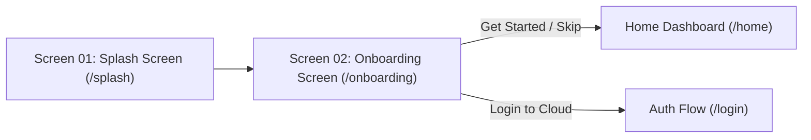

# AgriCare AI (LeafAgro) 🌿
*AI-Based Multi-Crop Plant Disease Detection and Agricultural Assistant for Bangladeshi Farmers*

AgriCare AI is a production-grade, offline-first mobile application designed to empower smallholder farmers, agronomists, and field extension officers across Bangladesh. It identifies plant diseases directly on-device using a MobileNetV2 TensorFlow Lite neural network and provides verified treatment and prevention recommendations backed by Supabase cloud storage.

---

## 🎨 Master Design System

| Token | Color Code | Role & Usage |
|---|---|---|
| **Forest Green** | `#14532D` | Primary brand color, headers, primary buttons, active badges |
| **Fresh Green** | `#22C55E` | Secondary brand color, laser scanning beams, active indicators |
| **Lime Green** | `#A3E635` | Accent highlights, glowing digital nodes, tech reticles |
| **Soft Natural Green** | `#F4F9F1` | Background canvas, soothing natural tone for field use |
| **Dark Charcoal Green** | `#191C1B` | High-contrast readable typography for titles and body |
| **Surface White** | `#FFFFFF` | Cards, elevated sheets, high-contrast readable containers |

---

## 📱 Implemented Production Screens

### Screen 01: Splash Screen
- **Visuals:** Dark forest gradient with ambient floating bio-particles and micro-leaves.
- **Centerpiece:** Custom vector leaf logo with central midrib, circuit nodes, and an animated vertical laser scanning beam.
- **Animation Sequence:** 5-phase timeline (Background Fade → Leaf Growth & HUD Ring Expansion → AI Laser Scan Sweep → "LeafAgro" Brand & Tagline Reveal → Smooth Exit Transition).
- **Navigation:** Automatically transfers control to **Screen 02 (Onboarding)**.

### Screen 02: Onboarding Screen
- **Hero Illustration:** Custom vector illustration depicting a Bangladeshi rural farmer examining a green crop leaf while a smartphone projects an animated holographic AI laser scanning beam.
- **PageView Carousel (3 Curated Slides):**
  1. **Smart Plant Disease Detection (স্মার্ট ফসলের রোগ নির্ণয়):** AI-powered crop diagnosis and instant treatment advice.
  2. **Instant Offline Field Diagnosis (ইন্টারনেট ছাড়াই ক্ষেতের মাঠে পরীক্ষা):** Edge inference directly on mobile hardware without requiring internet connectivity.
  3. **Expert Care & Maximum Yield (বিশেষজ্ঞ অনুমোদিত কৃষি সেবা):** Certified chemical and organic treatments, fertilizer dosages, and preventive care.
- **Language Selector:** Top-right interactive toggle (`EN` and `বাংলা`) with instant bilingual UI state re-rendering via Riverpod.
- **Progress Indicators:** Animated 3-dot indicator (active elongated pill + inactive circular dots).
- **Action Buttons:** Full-width primary button (*Next* / *Get Started*) with smooth page traversal, and secondary *Skip* button routing directly to `/home`.

---

## 🚀 Navigation Flow



---

## 🛠️ Tech Stack & Architecture

- **Framework:** Flutter 3.x (Dart 3)
- **State Management:** Riverpod 2 (`StateNotifier`, `AsyncNotifier`, `Provider`)
- **Navigation:** GoRouter 14
- **Backend & Database:** Supabase (PostgreSQL, Row-Level Security, Cloud Storage)
- **AI / ML Runtime:** TensorFlow Lite (MobileNetV2 on-device inference)
- **Local Persistence:** SQLite (`sqflite`), `shared_preferences`
- **Localization:** Bilingual English & Bengali (বাংলা) support

---

## 📂 Project Structure

```text
leaf_agro/
├── ai_model/                # Python ML training pipeline & TFLite export
├── supabase/                # PostgreSQL migrations, RLS policies, seed CSVs
├── documentation/           # Architecture, ERD, AI specs, test reports, manuals
├── assets/
│   ├── models/              # TFLite model, labels.json, model_metadata.json
│   └── translations/        # en.json, bn.json
└── lib/
    ├── app.dart             # MaterialApp.router with bilingual delegates
    ├── main.dart            # Entry point & provider scope setup
    ├── core/
    │   ├── constants/       # App & API constants
    │   ├── router/          # GoRouter configuration
    │   ├── theme/           # AppColors & AppTheme tokens
    │   ├── localization/    # Bilingual translation engine
    │   ├── errors/          # Custom failures and exceptions
    │   └── utils/           # Image & Date formatters
    ├── data/
    │   ├── models/          # Data models (Crops, Diseases, Predictions)
    │   ├── datasources/     # Local (TFLite, SQLite, Prefs) & Remote (Supabase)
    │   └── repositories/    # Auth, Crop, Detection, History repositories
    ├── features/
    │   ├── splash/          # Screen 01: Animated AI Splash Screen
    │   ├── onboarding/      # Screen 02: Farmer Hero & Bilingual Onboarding
    │   ├── auth/            # Login, Registration, Forgot Password
    │   ├── home/            # Dashboard, Quick diagnose, Field scans
    │   ├── crops/           # Crop encyclopedia & profile
    │   ├── diseases/        # Disease directory & details
    │   ├── detection/       # Camera scan, AI analyzer & Result cards
    │   ├── recommendations/ # Treatment & Prevention guides
    │   ├── history/         # Local & Cloud synchronized field log
    │   └── profile/         # User profile & preferences
    ├── providers/           # Riverpod state notifiers
    └── shared/widgets/      # Reusable buttons, badges, leaf image views
```

---

## 🏃 Running the Application

### 1. Install Dependencies
```bash
flutter pub get
```

### 2. Launch the Application
- **On Chrome Web Browser:**
  ```bash
  flutter run -d chrome
  ```
- **On Android Smartphone / Emulator:**
  ```bash
  flutter run -d android
  ```
- **On Windows Desktop:**
  ```bash
  flutter run -d windows
  ```
