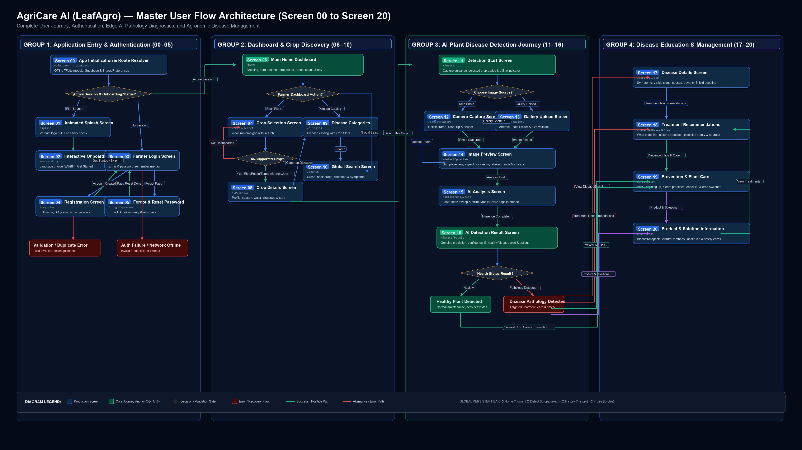
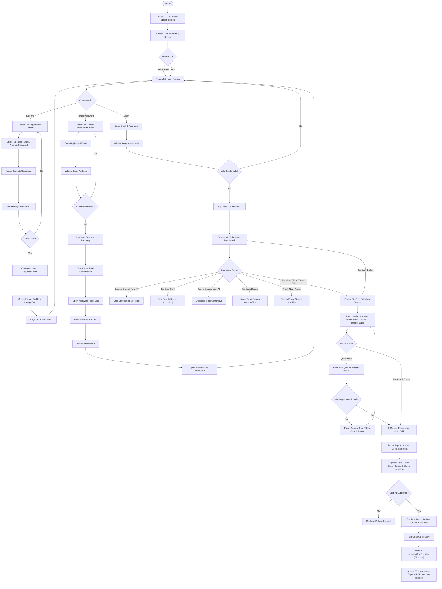

# AgriCare AI (LeafAgro) 🌿
*AI-Based Multi-Crop Plant Disease Detection and Agricultural Assistant for Bangladeshi Farmers*

AgriCare AI is a production-grade, offline-first mobile application designed to empower smallholder farmers, agronomists, and field extension officers across Bangladesh. It identifies plant diseases directly on-device using a MobileNetV2 TensorFlow Lite neural network and provides verified treatment and prevention recommendations backed by Supabase cloud storage.

---

## 🎨 Master Design System

| Token | Color Code | Role & Usage |
|---|---|---|
| **Forest Green** | `#14532D` | Primary brand color, headers, primary buttons, active badges |
| **Fresh Green** | `#22C55E` | Secondary brand color, laser scanning beams, active indicators |
| **Lime Green** | `#A3E635` | Accent highlights, glowing digital nodes, tech reticles |
| **Soft Natural Green** | `#F4F9F1` | Background canvas, soothing natural tone for field use |
| **Dark Charcoal Green** | `#191C1B` | High-contrast readable typography for titles and body |
| **Surface White** | `#FFFFFF` | Cards, elevated sheets, high-contrast readable containers |

---

## 🧭 Master Application Architecture & Flowchart (Screens 00 to 30)

AgriCare AI features **31 completed production screens** organized into **7 core functional modules**, providing an offline-first, seamless diagnostic and agricultural care workflow.


> **Complete Architecture Documentation**: See **[user_flow_architecture_00_30.md](documentation/user_flow_architecture_00_30.md)** for detailed navigation contracts, route parameters, Riverpod providers, and fallback mechanisms.

### 📱 7-Module Production Screen Map

| Module | Screen ID & Title | Route Path | Core Capabilities |
| :--- | :--- | :--- | :--- |
| **Module 1: Initialization & Authentication** | **Screen 00:** Route Resolver / Gate<br/>**Screen 01:** Animated Splash Screen<br/>**Screen 02:** Onboarding Carousel<br/>**Screen 03:** Farmer Login<br/>**Screen 04:** Farmer Registration<br/>**Screen 05:** Forgot / Reset Password | `/splash`<br/>`/splash`<br/>`/onboarding`<br/>`/login`<br/>`/register`<br/>`/forgot-password` | Session token validation, leaf laser brand animation, 3-slide value education, Supabase authentication, 64-district selector, self-service password recovery. |
| **Module 2: Home & Discovery** | **Screen 06:** Home Dashboard<br/>**Screen 07:** Crop Selection Screen<br/>**Screen 08:** Crop Detail Screen<br/>**Screen 09:** Disease Catalog Screen<br/>**Screen 10:** Global Search Screen<br/>**Screen 17:** Disease Detail Screen | `/home`<br/>`/crop-select`<br/>`/crops/:id`<br/>`/diseases`<br/>`/search`<br/>`/diseases/:id` | Central navigation hub, verified 5-crop selector, botanical profile, 19-class pathology encyclopedia, bilingual instant search, full disease pathology specs. |
| **Module 3: AI Vision Detection Pipeline** | **Screen 11:** Detection Start Screen<br/>**Screen 12:** Real-time Camera Viewfinder<br/>**Screen 13:** Gallery Upload Screen<br/>**Screen 14:** Image Review Screen<br/>**Screen 15:** AI Analyzing Screen<br/>**Screen 16:** AI Detection Result Screen | `/detect`<br/>`/detect/camera`<br/>`/detect/gallery`<br/>`/detect/preview`<br/>`/detect/analyzing`<br/>`/detect/result` | Photo guidelines, reticle-guided viewfinder, image picker with preflight validation, blur detection, on-device quantized MobileNetV2 inference, confidence gauge & severity badge. |
| **Module 4: Recommendations & Remedies** | **Screen 18:** Treatment Recommendations<br/>**Screen 19:** Prevention & Plant Care<br/>**Screen 20:** Product & Solution Info<br/>**Screen 21:** Plant Recovery & Follow-up | `/recommendations/:id`<br/>`/prevention`<br/>`/solutions`<br/>`/recovery` | Cultural, organic, and chemical remedies, long-term agronomic prevention, registered agrochemicals with dosage rates, longitudinal observation logger. |
| **Module 5: History & Monitoring** | **Screen 22:** Detection History Dashboard<br/>**Screen 23:** History Details Screen | `/history`<br/>`/history/:id` | Chronological scan archive, date range and crop filters, past scan breakdown with image comparison and treatment re-entry. |
| **Module 6: Profile & Settings** | **Screen 24:** User Profile Screen<br/>**Screen 25:** Settings Screen<br/>**Screen 26:** Language Selection Screen | `/profile`<br/>`/settings`<br/>`/settings/language` | Farmer credentials, district update, scan counters, offline cache management, model specs, live English/Bengali bilingual toggle. |
| **Module 7: Support & Governance** | **Screen 27:** Notifications Screen<br/>**Screen 28:** Help & FAQ Screen<br/>**Screen 29:** Feedback Screen<br/>**Screen 30:** About Application Screen | `/notifications`<br/>`/help`<br/>`/feedback`<br/>`/about` | Unread notifications, mark-as-read, 4 visual photo guides, 12 searchable FAQs, 5-star feedback form, academic capstone credentials and legal disclaimers. |

---

## 📱 Implemented Production Screens

### Screen 01: Splash Screen
- **Visuals:** Dark forest gradient with ambient floating bio-particles and micro-leaves.
- **Centerpiece:** Custom vector leaf logo with central midrib, circuit nodes, and an animated vertical laser scanning beam.
- **Animation Sequence:** 5-phase timeline (Background Fade → Leaf Growth & HUD Ring Expansion → AI Laser Scan Sweep → "LeafAgro" Brand & Tagline Reveal → Smooth Exit Transition).
- **Navigation:** Automatically transfers control to **Screen 02 (Onboarding)**.

### Screen 02: Onboarding Screen
- **Hero Illustration:** Custom vector illustration depicting a Bangladeshi rural farmer examining a green crop leaf while a smartphone projects an animated holographic AI laser scanning beam.
- **PageView Carousel (3 Curated Slides):**
  1. **Smart Plant Disease Detection (স্মার্ট ফসলের রোগ নির্ণয়):** AI-powered crop diagnosis and instant treatment advice.
  2. **Instant Offline Field Diagnosis (ইন্টারনেট ছাড়াই ক্ষেতের মাঠে পরীক্ষা):** Edge inference directly on mobile hardware without requiring internet connectivity.
  3. **Expert Care & Maximum Yield (বিশেষজ্ঞ অনুমোদিত কৃষি সেবা):** Certified chemical and organic treatments, fertilizer dosages, and preventive care.
- **Language Selector:** Top-right interactive toggle (`EN` and `বাংলা`) with instant bilingual UI state re-rendering via Riverpod.
- **Progress Indicators:** Animated 3-dot indicator (active elongated pill + inactive circular dots).
- **Action Buttons:** Full-width primary button (*Next* / *Get Started*) with smooth page traversal, and secondary *Skip* button routing directly to `/home`.

### Screen 03: Login Screen
- **Top Branding Section:** Custom `AuthLogoBadge` combining an emerald leaf silhouette, neural AI network nodes, and glowing lime scan accents with brand header "AgriCare AI".
- **Bilingual Interface:** Real-time `EN` / `বাংলা` toggle pill in the top bar instantly translating headings, form labels, hints, validation messages, and buttons.
- **Authentication Form:**
  - **Email Field:** Auto-complete, real-time regex validation, email icon prefix, soft green border (`#D1E7D2`), focused forest green border (`#14532D`).
  - **Password Field:** Visibility toggle, minimum 6-character validation, lock icon prefix, keyboard action submission.
  - **Options Row:** Custom-styled checkbox for "Remember me" alongside an instant navigation link to "Forgot Password?" (`/forgot-password`).
- **Primary Sign-In Action:** Full-width Forest Green button with embedded progress indicator connected to `authProvider` via Supabase authentication.
- **Social & Offline Access:**
  - **Continue with Google:** Custom vector 4-color Google 'G' emblem (`GoogleLogo`) with OAuth integration.
  - **Guest Access Bypass:** Dedicated "Continue as Guest (Offline Mode)" button for farmers in remote fields without cellular connectivity.
  - **Registration Link:** Direct route to `/register`.

### Screen 04: Registration Screen
- **Top Branding Section:** AgriCare AI leaf/AI badge, title "AgriCare AI", main heading *"Create Your Account"* (*"নতুন অ্যাকাউন্ট তৈরি করুন"*), and subtitle *"Join AgriCare AI and protect your crops."* (*"AgriCare AI-এ যোগ দিন এবং আপনার ফসল সুরক্ষিত রাখুন।"*).
- **Bilingual Toggle:** Instant switching between English and Bengali (`EN` | `বাংলা`) with immediate UI reactivity.
- **Registration Form (5 Essential Fields):**
  1. **Full Name:** Required, capitalized, minimum 2 characters, leading person icon (`Icons.person_outline_rounded`).
  2. **Email Address:** Required, email regex validation, email icon (`Icons.alternate_email_rounded`), email keyboard.
  3. **Bangladesh Phone Number (+880):** Visual Bangladesh flag badge with isolated `+880` country code container and editable field for 10-digit mobile number (`1XXXXXXXXX`). Automatically standardizes to international E.164 format (`+8801XXXXXXXXX`).
  4. **Password:** Minimum 8 characters, at least 1 letter, at least 1 number. Real-time visual checklist helper verifying strength criteria as the user types. Independent visibility toggle.
  5. **Confirm Password:** Independent visibility toggle, enforces exact matching with the password field.
- **Terms & Conditions:** Green active checkbox requiring acceptance of Terms & Conditions and Privacy Policy. Clickable links launch informative dialogs explaining farmer data privacy and advisory usage.
- **Create Account Button:** Full-width Forest Green (`#14532D`) button with loading spinner, preventing duplicate requests and routing to Supabase Auth.
- **Existing Account Login Section:** *"Already have an account? Login"* with clickable Forest Green text navigating directly to `/login`.

### Screen 05: Forgot Password & Password Recovery
- **Hero Illustration:** Custom vector `RecoveryHeroIllustration` rendering a floating white envelope, fresh green agricultural leaf midrib, circular ambient halo, bio-particles, and an account security lock emblem (or green checkmark badge in confirmed state).
- **Three-Phase Screen States (AnimatedSwitcher):**
  1. **Initial State:** User inputs registered email; email format is verified in real-time.
  2. **Loading State:** Button presents a smooth progress spinner, preventing duplicate recovery calls.
  3. **Confirmation State:** Displays *"Check Your Email"* (*"আপনার ইমেইল চেক করুন"*), dynamic email mention, spam folder advisory, primary button navigating back to Login, and a secondary *"Resend Email"* action with an interactive 30-second cooldown timer.
- **Dedicated Reset Password Flow (`/reset-password`):** Supports deep linking (`agricareai://reset-password`) for setting a new password with interactive strength checks after opening the recovery email.
- **Backend Recovery Integration:** Standardized `sendPasswordResetEmail(email)` method in `AuthService` connecting directly to Supabase Auth.

### Screen 06: Main Home Dashboard
- **Top Header:** Dynamic time-of-day greeting ("Good Morning / শুভ সকাল"), dynamic authenticated farmer name, user profile avatar with photo/initials, unread notification counter badge, and instant bilingual language toggle (`EN` | `বাংলা`).
- **Plant Health Detection Hero:** Large green gradient hero card (`#14532D` to `#22C55E`) with holographic AI scanning laser beam animation over crop leaf and prominent tactile `Scan Plant` button routing to `/crop-select`.
- **Compact Statistics:** Real-time metrics calculated from actual scan records: **Total Scans**, **Healthy Detections**, and **Disease Detections**.
- **Explore Crops Section:** Horizontal scrollable carousel containing the 5 verified AI crops (**Rice**, **Mango**, **Potato**, **Tomato**, **Jute**) with high-resolution imagery and details routing.
- **Recent Detections:** Authenticated user scan history sorted newest first with confidence scores, disease status badges, loading skeletons, and friendly empty state.
- **Fixed Bottom Navigation:** Clean 4-item bar (**Home**, **Detect**, **History**, **Profile**) respecting safe areas.

### Screen 07: Crop Selection Screen
- **Step 01 Header:** Clean back navigation returning to Dashboard, Step 01 indicator, heading *"Select Your Crop"* (*"ফসল নির্বাচন করুন"*), and bilingual subtitle.
- **Real-Time Search Field:** Live filter matching crop names in both English and Bengali (e.g. "Rice", "ধান", "Potato", "আলু") with instant clear button.
- **AI-Model Verified Catalogue:** Strictly presents only crops supported by the MobileNetV2 AI model (**Rice**, **Potato**, **Tomato**, **Mango**, **Jute**); prevents non-model vegetables from false AI promises.
- **Interactive 2-Column Grid:** Crop cards with realistic agricultural imagery, "AI Ready" tag, number of detectable disease classes, and tactile press animation.
- **Selection Visual Feedback:** Fresh Green border (`#22C55E`, 2.4px), soft green background tint (`#F0FDF4`), and circular check indicator.
- **Fixed Continue Button:** Fixed at bottom respecting safe areas, disabled when unselected, activates upon selection to write to `selectedCropProvider` (Riverpod) and route to Screen 08 (`/detect`).

---

## ☁️ Supabase Backend Architecture

AgriCare AI is backed by a secure PostgreSQL architecture on Supabase with Row Level Security (RLS), automated triggers, and encrypted object storage:

### Database Tables & Schema

| Table Name | Primary Key | Description & Foreign Keys | Security / RLS |
|---|---|---|---|
| `profiles` | `id (UUID)` | References `auth.users(id)`. Stores `full_name`, `email`, `phone_number`, `avatar_url`, `preferred_language`, `role`, `terms_accepted_at`. | RLS enabled: Users read & update own profile; role escalation strictly blocked by trigger. |
| `farmer_crops` | `id (UUID)` | References `profiles(id)`. Stores `crop_name`, `crop_variety`, `planting_date`, `farm_location`. | RLS enabled: Isolated strictly to `auth.uid() = user_id`. |
| `disease_scans` | `id (UUID)` | References `profiles(id)` and `farmer_crops(id)`. Stores `image_url`, `crop_name`, `detected_disease`, `confidence_score`, `severity`, `detection_result` (JSONB). | RLS enabled: Farmers can view, insert, and delete only their own scans. |
| `treatment_history` | `id (UUID)` | References `profiles(id)` and `disease_scans(id)`. Stores `treatment_name`, `treatment_description`, `prevention_tips` (JSONB). | RLS enabled: Strict user ownership (`auth.uid() = user_id`). |
| `notifications` | `id (UUID)` | References `profiles(id)`. Stores `title`, `message`, `is_read` boolean flag. | RLS enabled: Farmers read & update read status of their own notifications. |
| `feedback` | `id (UUID)` | References `profiles(id)`. Stores farmer satisfaction ratings (1-5) and messages. | RLS enabled: Farmers submit and view their own feedback. |
| `crops` & `disease_catalog` | `id (BIGINT)` | Public catalog of plant species and verified plant pathologies. | Public read-only for anonymous & authenticated users. |

### Supabase Storage Buckets

1. **`disease-images` (Private):** Secure storage for captured crop leaf photos. Enforces folder-level ownership: `(storage.foldername(name))[1] = auth.uid()::text`.
2. **`profile-images` (Public Read, Owner Write):** User avatar storage with owner-restricted upload/update access.

### Modular Backend Services

- `AuthService` (`lib/services/auth_service.dart`): Handles sign up, email login, Google OAuth, sign out, password recovery email dispatch, and password updating.
- `UserService` (`lib/services/user_service.dart`): Profile fetching, updates, avatar uploads, and account deletion.
- `CropService` (`lib/services/crop_service.dart`): Farmer field crop management.
- `DiseaseScanService` (`lib/services/disease_scan_service.dart`): Disease scan logging and treatment history tracking.
- `StorageService` (`lib/services/storage_service.dart`): Binary image uploads, signed URLs, and file deletion.

---

## 🚀 Complete Application Navigation Flow





---

## 🛠️ Tech Stack & Architecture

- **Framework:** Flutter 3.x (Dart 3)
- **State Management:** Riverpod 2 (`StateNotifier`, `AsyncNotifier`, `Provider`)
- **Navigation:** GoRouter 14
- **Backend & Database:** Supabase (PostgreSQL, Row-Level Security, Cloud Storage)
- **AI / ML Runtime:** TensorFlow Lite (MobileNetV2 on-device inference)
- **Local Persistence:** SQLite (`sqflite`), `shared_preferences`
- **Localization:** Bilingual English & Bengali (বাংলা) support

---

## 📂 Project Structure

```text
leaf_agro/
├── ai_model/                # Python ML training pipeline & TFLite export
├── supabase/                # PostgreSQL migrations, RLS policies, seed CSVs
├── documentation/           # Architecture, ERD, AI specs, test reports, manuals
├── assets/
│   ├── models/              # TFLite model, labels.json, model_metadata.json
│   └── translations/        # en.json, bn.json
└── lib/
    ├── app.dart             # MaterialApp.router with bilingual delegates
    ├── main.dart            # Entry point & provider scope setup
    ├── core/
    │   ├── constants/       # App & API constants
    │   ├── router/          # GoRouter configuration
    │   ├── theme/           # AppColors & AppTheme tokens
    │   ├── localization/    # Bilingual translation engine
    │   ├── errors/          # Custom failures and exceptions
    │   └── utils/           # Image & Date formatters
    ├── data/
    │   ├── models/          # Data models (Crops, Diseases, Predictions)
    │   ├── datasources/     # Local (TFLite, SQLite, Prefs) & Remote (Supabase)
    │   └── repositories/    # Auth, Crop, Detection, History repositories
    ├── features/
    │   ├── splash/          # Screen 01: Animated AI Splash Screen
    │   ├── onboarding/      # Screen 02: Farmer Hero & Bilingual Onboarding
    │   ├── auth/            # Login, Registration, Forgot Password
    │   ├── home/            # Dashboard, Quick diagnose, Field scans
    │   ├── crops/           # Crop encyclopedia & profile
    │   ├── diseases/        # Disease directory & details
    │   ├── detection/       # Camera scan, AI analyzer & Result cards
    │   ├── recommendations/ # Treatment & Prevention guides
    │   ├── history/         # Local & Cloud synchronized field log
    │   └── profile/         # User profile & preferences
    ├── providers/           # Riverpod state notifiers
    └── shared/widgets/      # Reusable buttons, badges, leaf image views
```

---

## 🏃 Running the Application

### 1. Install Dependencies
```bash
flutter pub get
```

### 2. Launch the Application
- **On Chrome Web Browser:**
  ```bash
  flutter run -d chrome
  ```
- **On Android Smartphone / Emulator:**
  ```bash
  flutter run -d android
  ```
- **On Windows Desktop:**
  ```bash
  flutter run -d windows
  ```
