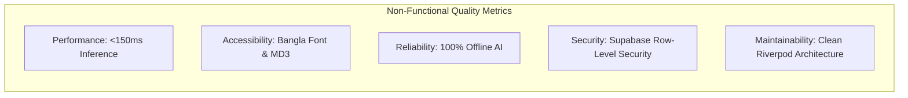

# AgriCare AI — Features and Requirements

## 1. Functional Requirements (FR)

### Module 1: Initialization & Authentication
- **FR-01 (Splash & Route Gate)**: The system must verify authentication token validity and route users to `/onboarding`, `/login`, or `/home` within 1.5 seconds.
- **FR-02 (Farmer Registration)**: The system shall capture farmer name, email/phone, password, and home district (64 districts of Bangladesh).
- **FR-03 (Security)**: The system must enforce SHA-256 / bcrypt authentication via Supabase Auth with secure session persistence.

### Module 2: Discovery & Education
- **FR-04 (Crop Catalog)**: Display detailed agronomy cards for Rice, Potato, Tomato, Mango, and Jute, including optimal growing temperatures, water requirements, and common diseases.
- **FR-05 (Disease Encyclopedia)**: Provide complete disease profiles containing high-resolution reference images, causal agents, early/advanced symptoms, and transmission vectors.
- **FR-06 (Global Search)**: Support instant, fuzzy, bilingual keyword search across crop names, disease titles, and common symptoms.

### Module 3: Computer Vision & AI Diagnosis
- **FR-07 (Camera Viewfinder)**: Provide real-time leaf alignment guides with visual bounding boxes, lighting warnings, and tap-to-focus.
- **FR-08 (Gallery Preflight)**: Validate image resolution (minimum 224x224), orientation, file type (JPEG, PNG), and file size (< 15MB).
- **FR-09 (Offline Inference)**: Process images using an on-device TensorFlow Lite model within 150ms without network connectivity.
- **FR-10 (Diagnostic Categorization)**: Output predicted disease class, confidence percentage (0.0% to 100.0%), and severity assessment (Low, Moderate, High, Critical).

### Module 4: Agronomic Recommendations & Solutions
- **FR-11 (Three-Tiered Guidance)**: Display tabbed recommendations covering Cultural/Sanitation, Organic/Biological, and Chemical options.
- **FR-12 (Dosage Calculation)**: Display precise mixing ratios (e.g., 2 ml per liter of water) and spraying safety precautions.
- **FR-13 (Commercial Solutions)**: Provide a directory of approved fungicides, bactericides, and bio-pesticides commonly available in Bangladesh.

### Module 5: Recovery, History & User Profile
- **FR-14 (Recovery Logs)**: Allow farmers to record visual observation checkpoints ('Better', 'No Change', 'Worse', 'Not Sure') and text notes for past scans.
- **FR-15 (Audit Archive)**: Store scan history locally and synchronize with Supabase PostgreSQL, allowing filtering by date range, crop, and disease.
- **FR-16 (Profile Management)**: Provide statistics on total scans completed, registered crops, district location, and account creation dates.
- **FR-17 (Bilingual Switcher)**: Allow real-time language toggling between English and Bangla across all screens without application restart.

---

## 2. Non-Functional Requirements (NFR)

| Metric | Target Standard | Verification Method |
| :--- | :--- | :--- |
| **Inference Latency** | $\le 150$ milliseconds on mid-range ARM CPU | Benchmark on Android device via `TFLiteService` |
| **Offline Operation** | 100% core diagnostic pipeline functional without internet | Airplane mode flight tests |
| **UI Responsiveness** | Consistent 60 FPS frame rate | Flutter DevTools Performance Overlay |
| **Cold Startup Time** | $< 2.0$ seconds to interactive dashboard | Android Vitals cold start profiling |
| **Database Security** | Zero unauthorized data access across users | Supabase Row Level Security (RLS) policies |
| **Localization Parity** | 100% parity across all 31 screens | Automated string matching and widget tests |
