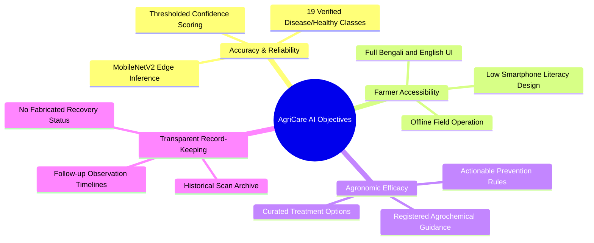

# AgriCare AI — Project Objectives

## 1. Primary Objectives
The central mission of **AgriCare AI (LeafAgro)** is to deliver an accessible, AI-powered diagnostic and advisory platform that empowers Bangladeshi farmers to detect plant illnesses early, apply scientifically verified remedies, and safeguard crop productivity.

---

## 2. Specific Technical & Operational Goals

### A. Machine Learning & Computer Vision
1. **Edge-First Inference**:
   Deploy an ultra-lightweight deep learning classifier capable of executing on low-end Android smartphones (Android 7.0+, ARMv7/ARM64) in under 150ms per frame without network roundtrips.
2. **Multi-Crop Pathology Classification**:
   Correctly classify 19 distinct visual conditions across 5 dominant regional crops: Rice, Potato, Tomato, Mango, and Jute.
3. **Rigorous Quality Gate & Ambiguity Handling**:
   Enforce confidence thresholding (minimum 0.70 high-confidence boundary) to prevent false assurances on blurry, poorly illuminated, or non-foliar inputs.

### B. Software Engineering & Architecture
1. **Offline Resilience & Data Synchronization**:
   Ensure all critical discovery, camera capture, neural network inference, and recommendation browsing workflows work 100% offline. Synchronize history logs, farmer feedback, and notifications to Supabase PostgreSQL whenever connectivity is reestablished.
2. **Type-Safe, Reactive State Architecture**:
   Utilize Flutter Riverpod (`StateNotifierProvider`, `FutureProvider`) to enforce immutable, unidirectional state flows across all 31 operational screens (Screens 00 through 30).
3. **Declarative Navigation**:
   Implement GoRouter 14.x with explicit route parameters, strict URL schema, back-stack preservation, and resilient error fallback routes.

### C. Agronomic Advisory & Safe Remediation
1. **Multi-Modal Remediation Pathways**:
   Provide practical cultural management, certified biological controls, and registered chemical solutions for every pathogenic class.
2. **Safe Dosage & Active Ingredients**:
   Provide exact active ingredients (e.g., Mancozeb, Copper Oxychloride, Streptocycline), water dilution ratios (e.g., 2g/L of water), and safety pre-harvest intervals (PHI) to prevent agrochemical toxicity.
3. **Continuous Monitoring Without Deception**:
   Facilitate Screen 21 (Recovery & Follow-up) as an honest observational log. Prohibit automated claims of "Full Recovery" without an authentic, new camera scan.

### D. User Experience & Human-Centered Design
1. **Dual Language Support (বাংলা & English)**:
   Provide 100% bilingual parity across all UI strings, button labels, diagnostic descriptions, and push notifications using Google Fonts `Noto Sans Bengali`.
2. **Accessible Form Factors**:
   Incorporate high-touch targets (minimum 48x48 dp), high-contrast Material 3 surfaces, and iconography designed for users with varied literacy levels.
