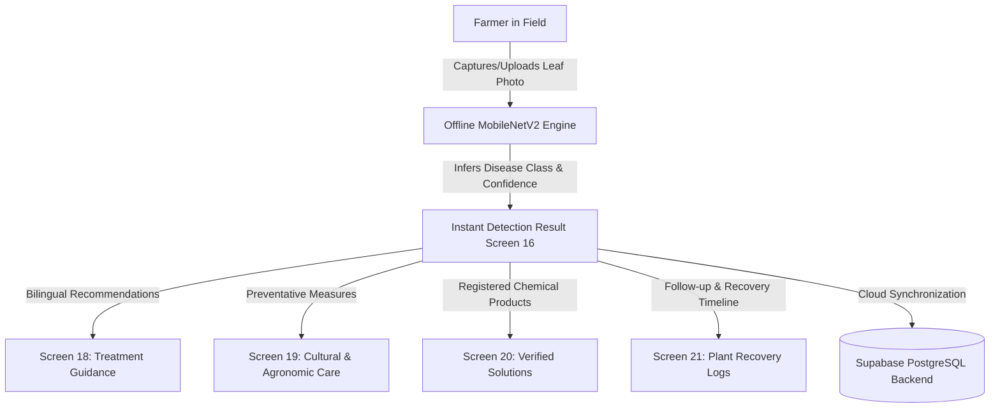

# AgriCare AI (LeafAgro) — Project Overview

## 1. Executive Summary
**AgriCare AI (LeafAgro)** is an intelligent, offline-capable agricultural advisory and plant disease diagnosis application tailored specifically for Bangladeshi smallholder farmers, agricultural extension workers, and students. Developed as an academic final-year capstone project in the Department of Computer Science & Engineering, AgriCare AI bridges the gap between deep learning vision systems and real-world field agronomy.

The system addresses the critical threat posed by agricultural pests and diseases to Bangladesh's primary economic crops: **Rice (ধান), Potato (আলু), Tomato (টমেটো), Mango (আম), and Jute (পাট)**. By combining on-device TensorFlow Lite image classification with a resilient cloud backend powered by Supabase PostgreSQL, AgriCare AI delivers instant, reliable disease diagnosis without requiring a constant cellular data connection in remote rural farmlands.

---

## 2. Problem Statement
Agriculture is the foundation of rural livelihood and national food security in Bangladesh, employing more than 40% of the active labor force. However, farmers suffer catastrophic crop losses—estimated at 15% to 25% of annual harvest yields—due to delayed or inaccurate detection of fungal, bacterial, and pest-induced leaf infections.

Traditional agricultural advisory faces systemic bottlenecks:
- **Low Extension Worker Ratio**: One agricultural extension officer often oversees 1,000–1,500 farming families across geographically dispersed unions.
- **Misuse of Agrochemicals**: In the absence of timely expert advice, farmers frequently misdiagnose symptoms, resulting in excessive, untimely, or inappropriate pesticide applications that degrade soil microbiology, poison waterways, and drive financial debt.
- **Intermittent Connectivity**: Rural farmlands in Bangladesh frequently encounter unreliable 3G/4G coverage, rendering purely cloud-dependent AI applications unusable in field conditions.
- **Language and Usability Barriers**: Existing agro-apps are often text-heavy, English-only, and complex, failing to accommodate farmers with basic smartphone literacy.

---

## 3. The AgriCare AI Solution
AgriCare AI offers a farmer-centric, bilingual mobile platform built upon five foundational pillars:

1. **Instant On-Device Classification**:
   Leverages an optimized MobileNetV2 architecture running via `tflite_flutter` on 224x224 RGB leaf images. Inference executes in under 150ms directly on the mobile CPU/NPU without consuming mobile data.
2. **19 Verified Diagnostic Classes**:
   Spans 5 vital Bangladeshi crops covering 14 pathogenic conditions and 5 healthy states, reflecting real agricultural challenges across Bangladeshi divisions.
3. **Actionable, Evidence-Based Recommendations**:
   Goes far beyond raw classification labels by providing three-tiered intervention strategies:
   - **Cultural & Agronomic Practices**: Sanitation, crop rotation, irrigation management, and field spacing.
   - **Organic & Biological Remedies**: Bio-fungicides, neem extracts, and biocontrol agents.
   - **Chemical Treatments**: Registered active ingredients, precise dosage per decimal/hectare, and application safety intervals.
4. **Transparent Historical Audit & Recovery Follow-up**:
   Enables farmers to log condition observations ('Better', 'No Change', 'Worse'), track post-treatment changes over time, and schedule follow-up scans without false claims of automatic recovery.
5. **Universal Accessibility & Dual-Language Architecture**:
   Full localization in both English and Bengali (বাংলা) powered by Google Fonts `Noto Sans Bengali`, high-contrast color palettes, audio-visual feedback, and zero-learning-curve navigation.

---

## 4. Key Target Audiences
- **Marginal and Smallholder Farmers**: Farmers managing 0.5 to 3 acres who require fast, free, and accessible plant health assessments.
- **Sub-Assistant Agriculture Officers (SAAOs)**: Field extension workers seeking a rapid diagnostic verification tool during field visits.
- **Agricultural University Researchers & Students**: Academics researching computer vision applications for tropical plant pathology and crop disease epidemiology.
- **Agro-Input Retailers**: Local fertilizer and pesticide dealers seeking accurate active-ingredient guidance to prevent harmful chemical misapplications.

---

## 5. Academic Project Identity
- **Project Title**: AI-Based Multi-Crop Plant Disease Detection and Recommendation System
- **App Name / Brand**: AgriCare AI (LeafAgro)
- **Department**: Department of Computer Science & Engineering
- **Faculty**: Faculty of Engineering & Technology
- **Project Stage**: Final-Year Academic Capstone Project (Undergraduate Thesis)
- **Model Version**: 1.0.0
- **App Version**: 1.0.0+1

