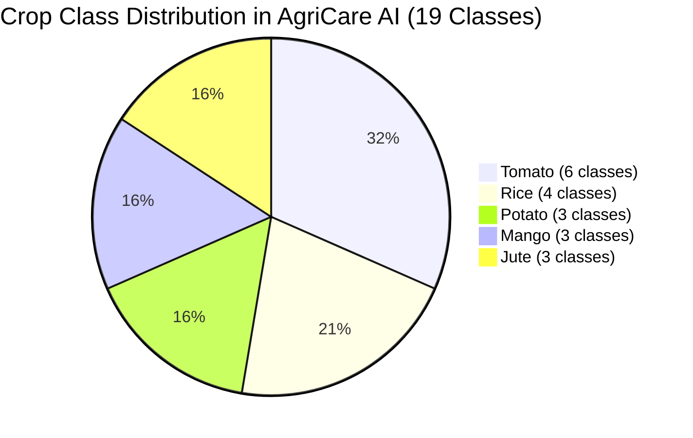

# AgriCare AI — Project Scope

## 1. Functional Scope

### A. Core Modules Included
The operational scope of AgriCare AI encompasses 31 dedicated screens organized into 8 interconnected functional modules:

| Module Number | Functional Domain | Screens Included | Primary Capabilities |
| :--- | :--- | :--- | :--- |
| **MOD-01** | **Initialization & Onboarding** | Screen 00, 01, 02 | Splash sequence, route gating, animated leaf branding, 3-step value carousel. |
| **MOD-02** | **Authentication & Identity** | Screen 03, 04, 05 | Phone/email authentication, farmer registration, district selection, password recovery. |
| **MOD-03** | **Discovery & Dashboard** | Screen 06, 07, 08, 09, 10 | Home summary, crop selector, crop agronomy guides, 19-class disease catalog, global search. |
| **MOD-04** | **AI Disease Detection Pipeline** | Screen 11, 12, 13, 14, 15, 16 | Real-time camera viewfinder, positioning guides, gallery picker, image preflight, neural inference, detection results. |
| **MOD-05** | **Recommendations & Advisory** | Screen 17, 18, 19, 20 | Pathological details, cultural/organic/chemical treatments, prevention guides, commercial solution directory. |
| **MOD-06** | **Monitoring & History Audit** | Screen 21, 22, 23 | Longitudinal recovery timeline, farmer condition logs, history dashboard with date/crop filters, scan re-inspection. |
| **MOD-07** | **Profile & Preferences** | Screen 24, 25, 26 | Farmer profile editing, scan statistics, system preferences, language switcher (English/বাংলা), offline cache management. |
| **MOD-08** | **Support & Governance** | Screen 27, 28, 29, 30 | Notification center, searchable FAQ support hub, 5-star feedback submission, academic final-year project disclosure. |

---

## 2. In-Scope Crops and Pathologies
The system classifies **19 specific classes** across **5 economically crucial crops**:

1. **Rice (Oryza sativa / ধান)**:
   - Bacterial Leaf Blight (*Xanthomonas oryzae*)
   - Brown Spot (*Bipolaris oryzae*)
   - Leaf Smut (*Entyloma oryzae*)
   - Healthy Rice Foliage
2. **Potato (Solanum tuberosum / আলু)**:
   - Early Blight (*Alternaria solani*)
   - Late Blight (*Phytophthora infestans*)
   - Healthy Potato Foliage
3. **Tomato (Solanum lycopersicum / টমেটো)**:
   - Bacterial Spot (*Xanthomonas perforans*)
   - Early Blight (*Alternaria solani*)
   - Late Blight (*Phytophthora infestans*)
   - Leaf Mold (*Passalora fulva*)
   - Septoria Leaf Spot (*Septoria lycopersici*)
   - Healthy Tomato Foliage
4. **Mango (Mangifera indica / আম)**:
   - Anthracnose (*Colletotrichum gloeosporioides*)
   - Bacterial Canker (*Xanthomonas citri*)
   - Healthy Mango Foliage
5. **Jute (Corchorus olitorius / পাট)**:
   - Stem Rot (*Macrophomina phaseolina*)
   - Anthracnose (*Colletotrichum corchori*)
   - Healthy Jute Foliage

---

## 3. Out-of-Scope Boundaries (Project Constraints)
To ensure academic honesty and technical viability, the following capabilities are explicitly defined as **outside the current project scope**:
- **Non-Foliar Diagnostics**: Symptoms manifested exclusively in roots, subterranean tubers, internal vascular tissue, or tree bark without foliar symptoms.
- **Unverified Crop Expansion**: Attempting to classify crops outside the trained 5 (e.g., wheat, maize, chili, cabbage) with high confidence. The app provides a low-confidence or unverified warning.
- **Automated Chemical Dispensing**: Hardware IoT integrations for automated sprayers or drone piloting.
- **Automated Recovery Guarantees**: Inferring plant cure based purely on elapsed calendar time without an active visual re-scan.
- **Commercial Payment Gateway**: Processing direct online sales of agrochemicals or fertilizers within the application.
