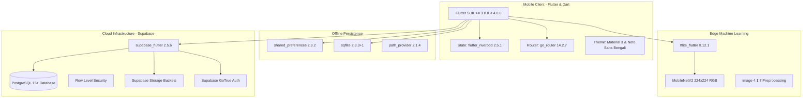

# AgriCare AI — Technology Stack

## 1. Overview
The **AgriCare AI (LeafAgro)** technology stack is architected around cross-platform mobile efficiency, on-device machine learning inference, and robust cloud data synchronization.

---

## 2. Component Specifications

### A. Mobile Application Framework
- **Framework**: Flutter (Google UI Toolkit)
- **Language**: Dart (SDK `>= 3.0.0 < 4.0.0`)
- **Design Language**: Material Design 3 (MD3) with customized agricultural green palettes:
  - Primary Green: `#2E7D32`
  - Emerald Green: `#10B981`
  - Leaf Accent: `#81C784`
  - Surface Background: `#F8FBF8`
- **Typography**: Google Fonts `Noto Sans Bengali` (ensuring flawless conjuncts and diacritics in Bengali script) and `Inter` for Latin characters.

### B. State Management & Navigation
- **State Architecture**: `flutter_riverpod` (`^2.5.1`) with `riverpod_annotation` (`^2.3.5`).
- **Pattern**: Unidirectional data flow using immutable state models and `StateNotifierProvider`.
- **Routing Engine**: `go_router` (`^14.2.7`) with declarative URI paths, typed parameters, sub-routes, and redirect guards.

### C. On-Device Machine Learning
- **ML Runtime**: `tflite_flutter` (`^0.12.1`) utilizing native Android C++ TensorFlow Lite binaries.
- **Model Architecture**: MobileNetV2 with depthwise separable convolutions.
- **Input Dimensions**: $224 \times 224 \times 3$ (RGB format).
- **Quantization / Normalization**: Preprocessing normalizes pixels to $[-1.0, 1.0]$:
  $$\text{Pixel}_{\text{norm}} = \frac{\text{Pixel} - 127.5}{127.5}$$
- **Output Activation**: Softmax activation across 19 class logits.

### D. Cloud Backend & Database
- **Platform**: Supabase (BaaS)
- **Database Engine**: PostgreSQL 15+
- **Authentication**: Supabase Auth (JWT with refresh token rotation).
- **Access Control**: PostgreSQL Row Level Security (RLS) guaranteeing strict tenant isolation.
- **Cloud Object Storage**: Supabase Storage (`plant-images`, `farmer-avatars`, `disease-assets`).

### E. Quality Assurance & Tooling
- **Testing Engine**: `flutter_test` (Unit, Widget, and Riverpod integration tests).
- **Code Generation**: `build_runner` (`^2.4.12`), `freezed` (`^2.5.7`), `json_serializable` (`^6.8.0`).
- **Static Analysis**: `flutter_lints` (`^4.0.0`) configured with strict analysis rules.
