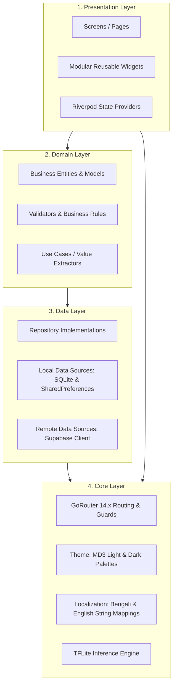

# AgriCare AI — Application Architecture

## 1. Clean Architecture Organization
AgriCare AI adheres to a modified feature-first Clean Architecture, isolating responsibilities into distinct layers:

---

## 2. Layer Detailed Responsibilities

### A. Presentation Layer (`lib/features/*/presentation/`)
- Contains Flutter widgets, responsive layouts, Material Design 3 cards, bottom sheets, and custom animated painters.
- Uses `ConsumerWidget` or `ConsumerStatefulWidget` to bind Riverpod state providers directly to the rendering cycle.
- **Rule**: Presentation widgets contain zero raw database queries or direct TFLite invocations; all actions are dispatched via Riverpod controllers.

### B. Domain Layer (`lib/data/models/`)
- Encapsulates domain models (`CropModel`, `DiseaseModel`, `PredictionModel`, `ObservationModel`, `NotificationItem`, `FeedbackModel`).
- Built with immutable data definitions, JSON serialization (`fromJson`/`toJson`), and defensive null-safety guards.

### C. Data Layer (`lib/data/repositories/`)
- Implements the Repository Pattern, abstracting the source of truth between local SQLite storage and remote Supabase tables.
- Handles data caching, network failure fallbacks, and synchronization queues.
- Example Repositories:
  - `CropRepository`: Queries local catalog and Supabase `crops` table.
  - `DiseaseRepository`: Manages 19-class pathology entities and diagnostic symptoms.
  - `HistoryRepository`: Persists detection history to SQLite and syncs with `disease_scans`.
  - `ObservationRepository`: Tracks longitudinal plant recovery checkpoints in `plant_observations`.
  - `FeedbackRepository`: Handles user ratings and feedback submissions.

### D. Core Infrastructure Layer (`lib/core/`)
- `lib/core/router/app_router.dart`: Centralized routing table registering Screens 00 through 30.
- `lib/core/theme/app_theme.dart`: Centralized theme tokens, seed colors, typography, card shapes.
- `lib/core/localization/`: Internationalization service supporting English (`en`) and Bengali (`bn`).
- `lib/core/services/tflite_service.dart`: Low-level image tensor manipulation and native C++ TFLite model execution.
