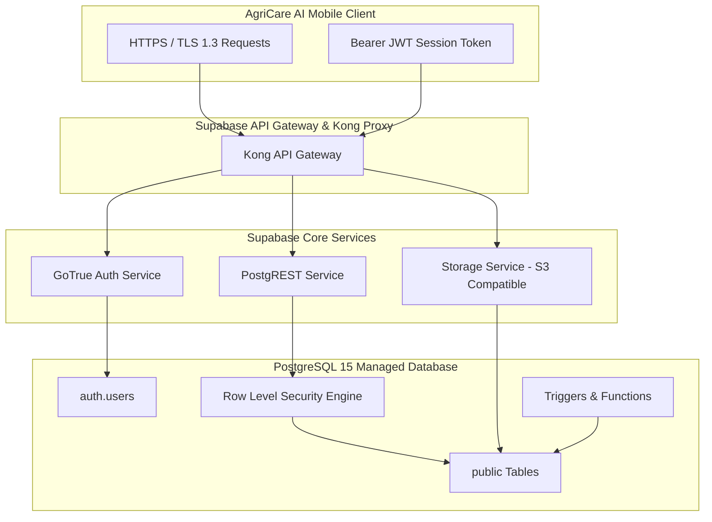

# AgriCare AI — Backend Architecture

## 1. Cloud Backend Overview
The backend infrastructure of AgriCare AI is built upon **Supabase Cloud**, providing an enterprise-grade PostgreSQL relational engine, built-in GoTrue authentication, object storage buckets, and auto-generated REST/Realtime endpoints.



---

## 2. Key Database Tables & Migrations
The database schema has evolved through 6 version-controlled migrations:

| Migration File | Key Tables / Enhancements | Purpose |
| :--- | :--- | :--- |
| `001_initial_schema.sql` | `profiles`, `crops`, `disease_catalog`, `recommendations`, `prediction_history`, `feedback`, `notifications` | Base relational schema and automatic profile creation trigger on signup. |
| `002_rls_policies.sql` | RLS enablement across all tables | Guarantees user data isolation using `auth.uid() = user_id`. |
| `003_seed_catalog.sql` | Seed records for 5 crops and 19 disease classes | Pre-populates verified agricultural information for offline/online synchronization. |
| `004_storage_policies.sql` | Storage buckets: `plant-images`, `farmer-avatars` | Bucket configurations and public read / authenticated upload security rules. |
| `005_complete_backend_architecture.sql` | `farmer_crops`, `disease_scans`, `treatment_history`, role escalation safeguards | Production-ready schema with indexed foreign keys and strict role constraints. |
| `006_plant_observations.sql` | `plant_observations` | Longitudinal observation tracking table for Screen 21 (Plant Recovery & Follow-up). |

---

## 3. Security & Row Level Security (RLS) Rules
All user-facing tables enforce strict PostgreSQL Row Level Security:

```sql
-- Example RLS Policy for Disease Scans
ALTER TABLE public.disease_scans ENABLE ROW LEVEL SECURITY;

CREATE POLICY "Users can view own disease scans"
ON public.disease_scans FOR SELECT TO authenticated
USING (auth.uid() = user_id);

CREATE POLICY "Users can insert own disease scans"
ON public.disease_scans FOR INSERT TO authenticated
WITH CHECK (auth.uid() = user_id);

CREATE POLICY "Users can delete own disease scans"
ON public.disease_scans FOR DELETE TO authenticated
USING (auth.uid() = user_id);
```

### Role Escalation Prevention
A dedicated PostgreSQL trigger prevents malicious clients from elevating their role to `admin` or `agronomist`:
```sql
CREATE OR REPLACE FUNCTION public.prevent_role_escalation()
RETURNS TRIGGER LANGUAGE plpgsql SECURITY DEFINER SET search_path = public AS $$
BEGIN
    IF NEW.role IS DISTINCT FROM OLD.role
       AND COALESCE(auth.jwt() ->> 'role', '') <> 'service_role'
    THEN
        RAISE EXCEPTION 'Role escalation is not permitted';
    END IF;
    NEW.updated_at = now();
    RETURN NEW;
END;
$$;
```

