# AgriCare AI — Component Diagram

## 1. System Component Overview
This diagram models the structural components of the AgriCare AI system and their inter-dependencies.

```mermaid
graph TB
    subgraph Client_App [AgriCare AI Mobile Client]
        subgraph UI_Components [UI Components]
            AuthUI[Auth Components: Login, Register, Forgot]
            HomeUI[Dashboard & Catalog Components]
            DetectUI[Camera Viewfinder, Gallery & Analyzing UI]
            ResultUI[Diagnosis, Treatment & Product UI]
            HistoryUI[History & Observation Timeline UI]
            ProfileUI[Profile, Settings, Help & About UI]
        end

        subgraph Core_Services [Core Services & State]
            AuthNotifier[Auth State Controller]
            PredNotifier[Prediction State Controller]
            HistoryNotifier[History State Controller]
            ObsNotifier[Observation State Controller]
            SettingsNotifier[Settings & Locale Controller]
            TFLiteService[TFLite Inference Engine]
            CameraService[Hardware Camera Controller]
            StorageService[Local Sandbox Storage Manager]
        end

        subgraph Data_Repositories [Repositories]
            AuthRepo[Auth Repository]
            CropRepo[Crop Repository]
            DiseaseRepo[Disease Repository]
            ScanRepo[Scan History Repository]
            ObsRepo[Observation Repository]
            FeedbackRepo[Feedback Repository]
        end
    end

    subgraph External_Services [External & Cloud Services]
        SupabaseAuth[Supabase GoTrue Auth]
        SupabaseDB[(Supabase PostgreSQL 15)]
        SupabaseStorage[Supabase Object Storage]
    end

    AuthUI --> AuthNotifier
    HomeUI --> CropRepo
    DetectUI --> CameraService
    DetectUI --> PredNotifier
    PredNotifier --> TFLiteService
    ResultUI --> DiseaseRepo
    HistoryUI --> HistoryNotifier
    HistoryUI --> ObsNotifier
    ProfileUI --> SettingsNotifier

    AuthNotifier --> AuthRepo
    PredNotifier --> ScanRepo
    HistoryNotifier --> ScanRepo
    ObsNotifier --> ObsRepo

    AuthRepo --> SupabaseAuth
    ScanRepo --> SupabaseDB
    ScanRepo --> StorageService
    ObsRepo --> SupabaseDB
    FeedbackRepo --> SupabaseDB
    ScanRepo -.->|Upload Scan Photo| SupabaseStorage
```

---

## 2. Component Descriptions

- **TFLiteService**: Loads `assets/models/plant_disease_model.tflite` into memory, allocates input and output tensor buffers, transforms captured bitmaps to $[224, 224, 3]$ floating-point tensors, and maps output probabilities to class names via `assets/models/labels.json`.
- **CameraService**: Interacts with the device's hardware camera through `camera: ^0.12.2`, controlling flash mode, focus points, aspect ratio, and photo capture resolution.
- **StorageService**: Coordinates local image caching in application documents directory (`path_provider`) and initiates background uploads to Supabase storage bucket `plant-images`.
- **ScanRepo (HistoryRepository)**: Manages dual-write logic: saves detection records immediately to local SQLite for instant retrieval, and synchronizes asynchronously with Supabase `disease_scans` table.
- **ObsRepo (ObservationRepository)**: Tracks subjective recovery milestones in `plant_observations` without altering original diagnostic records.

