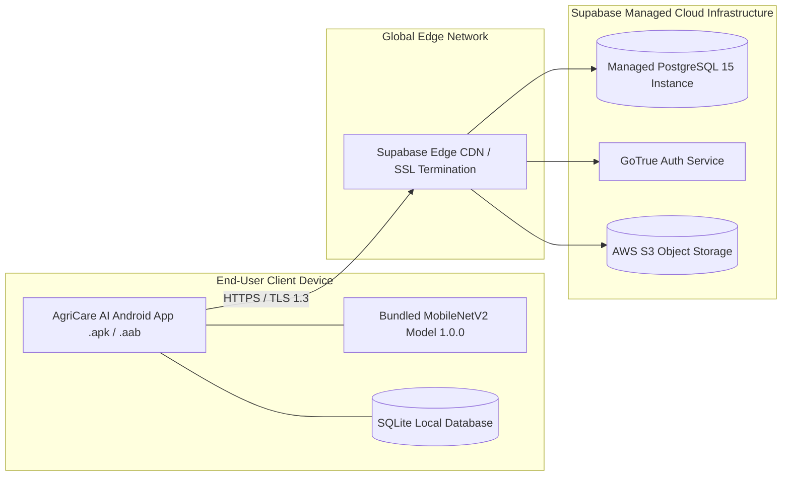

# AgriCare AI — Deployment Architecture

## 1. Deployment Topology
AgriCare AI employs a distributed deployment topology separating the client runtime (Android OS) from the serverless cloud backend (Supabase Cloud).

---

## 2. Client Packaging & Distribution
- **Target OS**: Android (API Level 21+ / Android 5.0 Lollipop through Android 14+).
- **Primary Architecture**: `arm64-v8a`, `armeabi-v7a`.
- **Packaging Format**: Android App Bundle (`.aab`) for Google Play Store distribution, and standalone `.apk` for direct sideloading by extension workers.
- **Embedded Assets**:
  - `assets/models/plant_disease_model.tflite`
  - `assets/models/labels.json`
  - `assets/models/model_metadata.json`
  - Localized assets, disease illustrations, crop icons.

---

## 3. Cloud Infrastructure & Hosting
- **Backend Host**: Supabase Cloud (AWS Singapore `ap-southeast-1` region for low latency across Bangladesh).
- **Compute Architecture**: Serverless containerized microservices managed by Supabase.
- **Data Persistence**:
  - PostgreSQL 15 instance with automatic daily backups and Point-In-Time-Recovery (PITR).
  - High availability multi-AZ storage.
  - S3-compatible cloud object storage with auto-scaling bandwidth.
