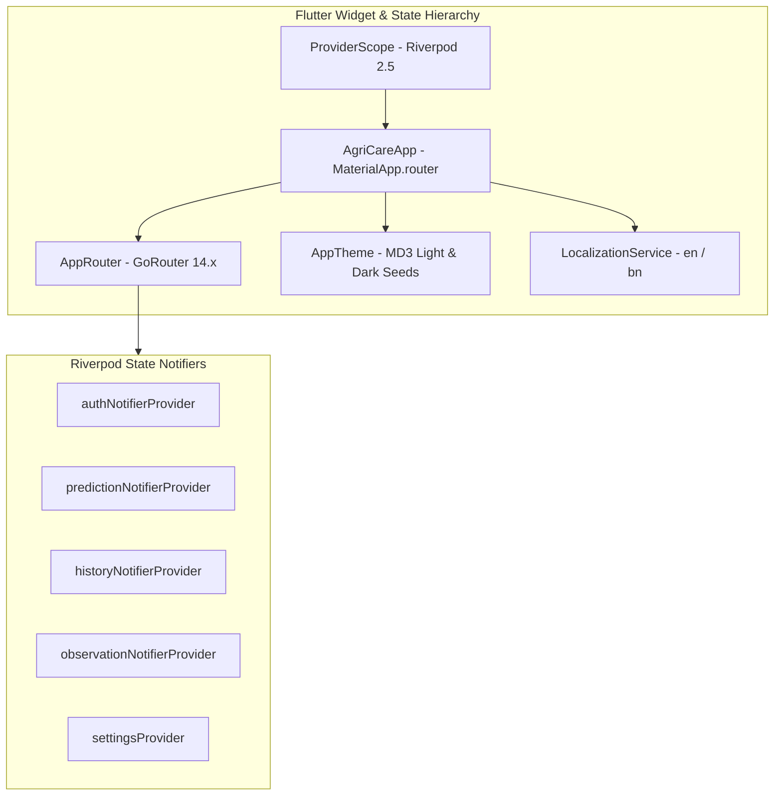

# AgriCare AI — Frontend Architecture

## 1. UI Framework & Design System
AgriCare AI is constructed on **Flutter 3.x** and **Dart 3.x**, following Google's **Material Design 3 (MD3)** specification. It emphasizes readability, high-contrast visual hierarchy, large touch affordances, and full bilingual support (English and Bengali).



---

## 2. Declarative Navigation Architecture (`go_router`)
All screen transitions are handled declaratively by `appRouter` in `lib/core/router/app_router.dart`:

```dart
final appRouter = GoRouter(
  initialLocation: '/splash',
  routes: [
    GoRoute(path: '/splash', builder: (context, state) => const SplashScreen()),
    GoRoute(path: '/onboarding', builder: (context, state) => const OnboardingScreen()),
    GoRoute(path: '/login', builder: (context, state) => const LoginScreen()),
    GoRoute(path: '/register', builder: (context, state) => const RegisterScreen()),
    GoRoute(path: '/forgot-password', builder: (context, state) => const ForgotPasswordScreen()),
    GoRoute(path: '/reset-password', builder: (context, state) => const ResetPasswordScreen()),
    GoRoute(path: '/home', builder: (context, state) => const HomeScreen()),
    GoRoute(path: '/crops', builder: (context, state) => const CropListScreen(), routes: [
      GoRoute(path: ':id', builder: (context, state) => CropDetailScreen(cropId: int.parse(state.pathParameters['id']!))),
    ]),
    GoRoute(path: '/crop-select', builder: (context, state) => const CropSelectionScreen()),
    GoRoute(path: '/diseases', builder: (context, state) => const DiseaseCatalogScreen(), routes: [
      GoRoute(path: ':id', builder: (context, state) => DiseaseDetailScreen(diseaseId: int.parse(state.pathParameters['id']!))),
    ]),
    GoRoute(path: '/detect', builder: (context, state) => const DetectionStartScreen(), routes: [
      GoRoute(path: 'camera', builder: (context, state) => const CameraScreen()),
      GoRoute(path: 'gallery', builder: (context, state) => const GalleryUploadScreen()),
      GoRoute(path: 'preview', builder: (context, state) => const ImagePreviewScreen()),
      GoRoute(path: 'analyzing', builder: (context, state) => const AnalyzingScreen()),
      GoRoute(path: 'result', builder: (context, state) => DetectionResultScreen(...)),
    ]),
    GoRoute(path: '/recommendations/:id', builder: (context, state) => TreatmentScreen(diseaseId: int.parse(state.pathParameters['id']!))),
    GoRoute(path: '/prevention', builder: (context, state) => PreventionScreen(...)),
    GoRoute(path: '/solutions', builder: (context, state) => SolutionsScreen(...)),
    GoRoute(path: '/recovery', builder: (context, state) => RecoveryScreen(...)),
    GoRoute(path: '/history', builder: (context, state) => const HistoryScreen(), routes: [
      GoRoute(path: 'filter', builder: (context, state) => const FilterSearchScreen()),
      GoRoute(path: ':id', builder: (context, state) => HistoryDetailScreen(scanId: state.pathParameters['id']!)),
    ]),
    GoRoute(path: '/profile', builder: (context, state) => const ProfileScreen(), routes: [
      GoRoute(path: 'edit', builder: (context, state) => const EditProfileScreen()),
    ]),
    GoRoute(path: '/settings', builder: (context, state) => const SettingsScreen(), routes: [
      GoRoute(path: 'language', builder: (context, state) => const LanguageScreen()),
    ]),
    GoRoute(path: '/notifications', builder: (context, state) => const NotificationsScreen()),
    GoRoute(path: '/help', builder: (context, state) => const HelpScreen()),
    GoRoute(path: '/feedback', builder: (context, state) => FeedbackScreen(...)),
    GoRoute(path: '/about', builder: (context, state) => const AboutScreen()),
    GoRoute(path: '/search', builder: (context, state) => GlobalSearchScreen(...)),
  ],
);
```

---

## 3. Bilingual Typography & Localization
The app incorporates Google Fonts `Noto Sans Bengali` to guarantee typographic accuracy and legibility for Bengali speakers:
- Real-time language switching without restart via `settingsProvider`.
- Automatic numerals translation (e.g., converting ASCII digits `0-9` to Bengali numerals `০-৯` where appropriate).
- High visual contrast compliant with WCAG 2.1 AA accessibility guidelines.
