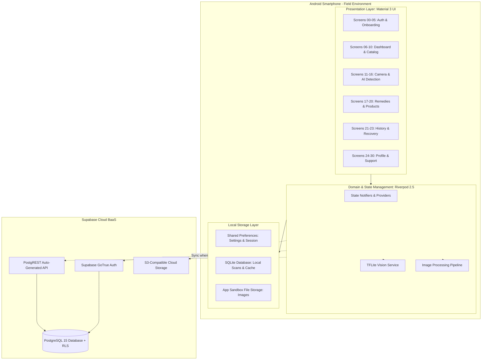

# AgriCare AI — System Architecture

## 1. High-Level Architecture
The **AgriCare AI (LeafAgro)** system follows a hybrid offline-first, client-server edge computing architecture. By decoupling on-device computer vision inference from cloud data synchronization, the system guarantees that farmers can inspect damaged crops in remote locations without network connectivity.

---

## 2. Core Architectural Principles

### A. Offline-First Mandate
- Deep learning inference operates strictly on the local hardware through `tflite_flutter` using native C++ TFLite runtime bindings.
- Seed catalogs (crops, diseases, treatments, prevention protocols, registered solutions) are stored directly inside local assets (`assets/translations/`, local mock databases) as well as cached in SQLite.
- When an internet connection is unavailable, the user can capture or upload images, perform complete disease analysis, view multi-tier treatments, and record observations without encountering blocking dialogs or errors.

### B. Unidirectional Data Flow (UDF)
- User interactions emit intents to Riverpod `StateNotifier` controllers.
- Notifiers communicate with domain repositories and mutate state in an immutable fashion.
- The UI listens reactively to provider states using `ref.watch()`, preventing race conditions, stale UI renders, or inconsistent back-stack transitions.

### C. Zero-Trust Security at the Edge
- The client app never possesses elevated database credentials.
- All database operations are mediated via Supabase PostgreSQL Row Level Security (RLS) policies locked to the authenticated user's JWT `auth.uid()`.
- Client role escalation is prevented at the database trigger layer (`prevent_role_escalation` trigger).
