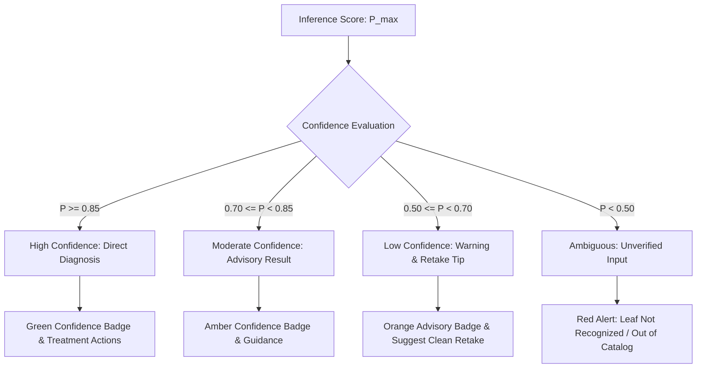

# AgriCare AI — Confidence Scoring and Prediction Logic

## 1. Softmax Confidence Interpretation
The MobileNetV2 output layer produces unnormalized logits $z_i$ across all 19 classes. Applying the standard Softmax activation function converts these logits into a normalized probability distribution:

$$P(\text{Class}_i) = \frac{e^{z_i}}{\sum_{j=1}^{19} e^{z_j}}$$

The highest probability $P_{\max} = \max_i P(\text{Class}_i)$ denotes the model's nominal **confidence score** ($0.000$ to $1.000$, or $0.0\%$ to $100.0\%$).

---

## 2. Confidence Thresholding Tiers

| Tier Name | Confidence Range | UI Representation | Farmer Advisory |
| :--- | :--- | :--- | :--- |
| **High Confidence** | $\ge 85.0\%$ | Solid Green Badge (`#2E7D32`) | Clear visual symptoms match verified model training; proceed with treatment protocols. |
| **Moderate Confidence** | $70.0\% - 84.9\%$ | Mint / Amber Badge (`#10B981` / `#D97706`) | Reliable identification; verify visible leaf symptoms against in-app symptom checklist. |
| **Low Confidence** | $50.0\% - 69.9\%$ | Amber / Orange Warning (`#F59E0B`) | Unclear image, mixed symptoms, or suboptimal lighting. Recommend capturing a new, closer photo in direct indirect light. |
| **Ambiguous / Unverified** | $< 50.0\%$ | Crimson Alert (`#DC2626`) | Image could not be confirmed as one of the 19 supported conditions. Suggest consulting a local sub-assistant agriculture officer (SAAO). |

---

## 3. Severity Level Estimation
Severity is evaluated by combining model confidence, predicted pathology characteristics, and visible lesion coverage:
- **Low Severity**: Early localized spots affecting less than 10% of leaf surface. Cultural prevention and organic remedies prioritized.
- **Moderate Severity**: Expanding lesions across 10% to 35% of leaf area. Integrated pest management (IPM) combining organic and targeted chemical treatments.
- **High / Critical Severity**: Extensive necrosis, wilting, or vascular blackening exceeding 35% of leaf blade. Immediate chemical intervention recommended to protect field yield.

