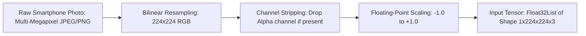

# AgriCare AI — Image Preprocessing

## 1. Preprocessing Requirements
Deep learning image classification networks require input images that conform strictly to expected tensor dimensions, color channel ordering, and value normalization. In AgriCare AI, incoming images undergo systematic preprocessing prior to model execution.

---

## 2. Mathematical Normalization Specification
The model was pre-trained using standard MobileNetV2 image preprocessing parameters:

$$\text{Pixel}_{\text{normalized}} = \frac{\text{Pixel}_{\text{uint8}} - 127.5}{127.5}$$

- **Input Domain**: Integers in range $[0, 255]$ representing 8-bit Red, Green, and Blue intensity values.
- **Output Domain**: Single-precision floating-point numbers in range $[-1.0, 1.0]$.
- **Zero Center**: 0.0 corresponds to an unnormalized intensity of $127.5$.

---

## 3. Handling Color Formats and Rotation
Smartphones capture photos with diverse EXIF orientations and color models (e.g., YUV420 on Android camera preview, BGRA, or RGBA).
- **EXIF Auto-Orientation**: The `image` package inspects EXIF metadata tags and rotates the bitmap so the leaf remains upright before bilinear resizing.
- **Alpha Channel Removal**: If an RGBA image is chosen from the device gallery, the 4th alpha channel is discarded to preserve the pure 3-channel RGB matrix.
- **Aspect Ratio Handling**: Resizing preserves leaf pathology spots through bilinear interpolation.
