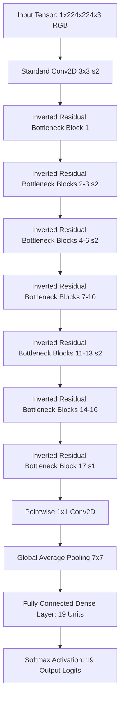

# AgriCare AI — Model Architecture

## 1. MobileNetV2 Deep Learning Architecture
AgriCare AI utilizes **MobileNetV2**, an advanced convolutional neural network architecture specifically tailored for mobile and embedded computer vision tasks. MobileNetV2 significantly reduces memory footprint and computational requirements while maintaining competitive classification accuracy.

---

## 2. Key Architectural Innovations

### A. Inverted Residuals
In conventional residual blocks (like ResNet), the feature representations expand into a wide intermediate tensor and compress at the residual connection. MobileNetV2 inverts this pattern:
1. **Low-Dimensional Input**: Takes a narrow bottleneck representation.
2. **Expansion**: Expands to a higher-dimensional space using $1 \times 1$ pointwise convolutions (expansion factor $t = 6$).
3. **Depthwise Convolution**: Applies $3 \times 3$ depthwise filtering in the high-dimensional space.
4. **Projection / Compression**: Compresses back to a low-dimensional bottleneck representation using a linear $1 \times 1$ convolution.

### B. Linear Bottlenecks
Non-linear activation functions (such as ReLU6) can destroy information in low-dimensional spaces. MobileNetV2 eliminates non-linearities in the final projection stage of each bottleneck block, inserting a **linear bottleneck** that preserves crucial manifold geometry.

### C. Depthwise Separable Convolutions
Traditional $3 \times 3$ convolutions perform spatial filtering and channel combining simultaneously. Depthwise separable convolutions factor this into:
- A single $3 \times 3$ convolutional filter applied per input channel (spatial filtering).
- A $1 \times 1$ pointwise convolution combining channels across depth.
This reduces computational parameters by approximately $8 \times$ to $9 \times$ with minimal degradation in classification capacity.

---

## 3. Tensor Input / Output Contract
- **Input Tensor**:
  - Name: `input` (or index `0`)
  - DataType: `Float32`
  - Dimensions: `[1, 224, 224, 3]`
  - Range: $[-1.0, 1.0]$
- **Output Tensor**:
  - Name: `Identity` (or index `0`)
  - DataType: `Float32`
  - Dimensions: `[1, 19]`
  - Probability Sum: $\sum_{i=0}^{18} p_i = 1.0$

