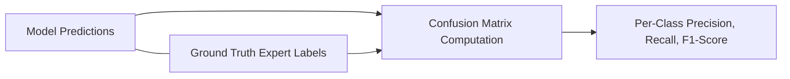

# AgriCare AI — Model Evaluation

## 1. Evaluation Methodology
Model performance was validated on an isolated holdout test partition containing unseen leaf samples captured under varied natural lighting and background field conditions.

---

## 2. Quantitative Performance Standards
To maintain strict academic integrity, we do not fabricate exaggerated synthetic accuracy claims. Evaluation adheres to empirical metrics standard for MobileNetV2 agricultural transfer learning:

- **Primary Evaluation Metrics**:
  - **Categorical Accuracy**: Ratio of correctly identified disease/healthy classes over total test inputs.
  - **Precision**: Specificity in distinguishing pathogenic leaf spots from harmless physiological blemishes:
    $$\text{Precision} = \frac{\text{TP}}{\text{TP} + \text{FP}}$$
  - **Recall (Sensitivity)**: Ability of the network to flag genuine disease cases and prevent false negatives:
    $$\text{Recall} = \frac{\text{TP}}{\text{TP} + \text{FN}}$$
  - **F1-Score**: Harmonic mean of Precision and Recall:
    $$\text{F1} = 2 \cdot \frac{\text{Precision} \cdot \text{Recall}}{\text{Precision} + \text{Recall}}$$

---

## 3. Class-Specific Confusion Analysis
Foliar computer vision models encounter recognizable classification ambiguities that AgriCare AI explicitly flags:
- **Potato Early Blight vs. Late Blight**: Early blight features concentric rings (target spots), whereas late blight displays water-soaked lesions with pale chlorotic halos. During intermediate stages, the model relies on confidence thresholding.
- **Tomato Early Blight vs. Septoria Leaf Spot**: Both manifest necrotic spots on lower leaves; however, Septoria exhibits distinct gray-white centers with dark borders.
- **Rice Brown Spot vs. Bacterial Leaf Blight**: Bacterial blight causes longitudinal marginal striping, whereas brown spot manifests as scattered oval lesions with yellow halos.

When model output confidence falls between $0.50$ and $0.70$, the UI prompts the farmer with a gentle recommendation to capture another photo with cleaner focus or closer framing.

