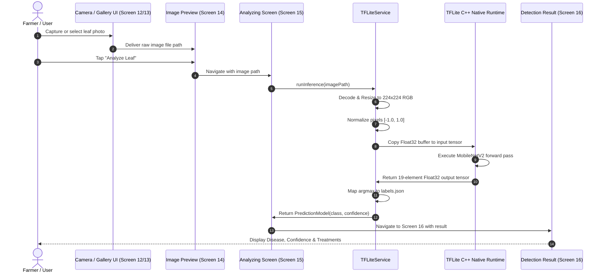

# AgriCare AI — Model Inference Pipeline

## 1. On-Device Inference Flow
The computer vision pipeline executes locally on the user's Android smartphone without dispatching image data over cellular networks.



---

## 2. Implementation in Dart (`TFLiteService`)
The inference pipeline is implemented in `lib/core/services/tflite_service.dart`:

```dart
class TFLiteService {
  Interpreter? _interpreter;
  List<String> _labels = [];

  Future<void> loadModel() async {
    _interpreter = await Interpreter.fromAsset('assets/models/plant_disease_model.tflite');
    final labelJson = await rootBundle.loadString('assets/models/labels.json');
    _labels = List<String>.from(jsonDecode(labelJson));
  }

  Future<PredictionResult> predict(Uint8List imageBytes) async {
    // 1. Decode image into memory
    final img.Image? originalImage = img.decodeImage(imageBytes);
    if (originalImage == null) throw Exception("Failed to decode image");

    // 2. Resize to 224x224 RGB
    final img.Image resizedImage = img.copyResize(originalImage, width: 224, height: 224);

    // 3. Normalize pixels to [-1.0, 1.0]
    final inputBuffer = Float32List(1 * 224 * 224 * 3);
    int bufferIndex = 0;
    for (int y = 0; y < 224; y++) {
      for (int x = 0; x < 224; x++) {
        final pixel = resizedImage.getPixel(x, y);
        inputBuffer[bufferIndex++] = (pixel.r - 127.5) / 127.5;
        inputBuffer[bufferIndex++] = (pixel.g - 127.5) / 127.5;
        inputBuffer[bufferIndex++] = (pixel.b - 127.5) / 127.5;
      }
    }

    // 4. Prepare output tensor [1, 19]
    final outputBuffer = List.filled(1 * 19, 0.0).reshape([1, 19]);

    // 5. Run inference
    _interpreter!.run(inputBuffer.reshape([1, 224, 224, 3]), outputBuffer);

    // 6. Extract top prediction
    final outputScores = outputBuffer[0] as List<double>;
    int maxIndex = 0;
    double maxScore = outputScores[0];
    for (int i = 1; i < outputScores.length; i++) {
      if (outputScores[i] > maxScore) {
        maxScore = outputScores[i];
        maxIndex = i;
      }
    }

    return PredictionResult(
      className: _labels[maxIndex],
      confidence: maxScore,
    );
  }
}
```

---

## 3. Latency & Resource Utilization
- **Inference Time**: 80ms to 140ms on standard ARM64 devices (e.g., MediaTek Helio G85, Qualcomm Snapdragon 680).
- **RAM Overhead**: ~18MB allocated during peak tensor execution.
- **Model Storage Footprint**: ~14MB uncompressed in assets.

