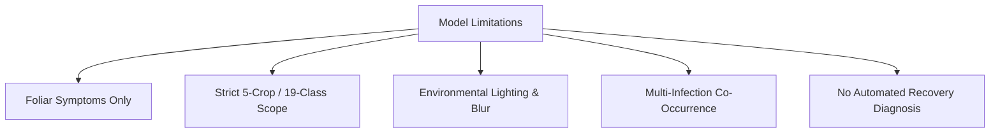

# AgriCare AI — Model Limitations and Safe Use

## 1. Known Technical Boundaries
While AgriCare AI offers high diagnostic performance on its target distribution, like all computer vision systems it operates within specific technical boundaries.

---

## 2. Specific Constraints & Edge Cases

### A. Non-Foliar Symptoms
- **Constraint**: The network is trained solely on leaf blades.
- **Impact**: Diseases manifesting strictly in root rot, subterranean tuber rotting, blossom end rot, or deep trunk heartwood cannot be detected by photographing leaves.

### B. Unseen Crops & Out-of-Distribution Inputs
- **Constraint**: The model was trained specifically on Rice, Potato, Tomato, Mango, and Jute.
- **Impact**: Submitting photographs of other crops (e.g., wheat, maize, brinjal, chili) or non-plant objects (e.g., human skin, fabric, soil) will result in low confidence scores. AgriCare AI enforces a confidence safety gate to prevent spurious diagnosis on arbitrary inputs.

### C. Co-Infection and Secondary Pathogens
- **Constraint**: Single-label classification model.
- **Impact**: When a leaf suffers from both insect chewing damage and fungal brown spot simultaneously, the model will output the visually dominant pathology rather than a multi-label breakdown.

### D. Glare, Shadows, and Motion Blur
- **Constraint**: Bilinear downsampling to $224 \times 224$ pixels reduces high-frequency detail.
- **Impact**: Photos taken with intense lens glare, harsh shadows, or severe hand shake may obscure tiny bacterial lesions (e.g., early Bacterial Spot), leading to reduced classification confidence.

---

## 3. Responsible AI & Academic Disclaimer
1. **Decision Support, Not Veterinary/Medical Panacea**:
   AgriCare AI serves as an agronomic decision-support assistant. In high-risk, catastrophic blight outbreaks, farmers are advised to cross-examine in-app suggestions with the Department of Agricultural Extension (DAE) or Upazila Agriculture Officers.
2. **Strict Adherence to Chemical Safety**:
   Farmers must always read manufacturer labels, observe Pre-Harvest Intervals (PHI), and use personal protective equipment (PPE) before spraying fungicides or pesticides.

