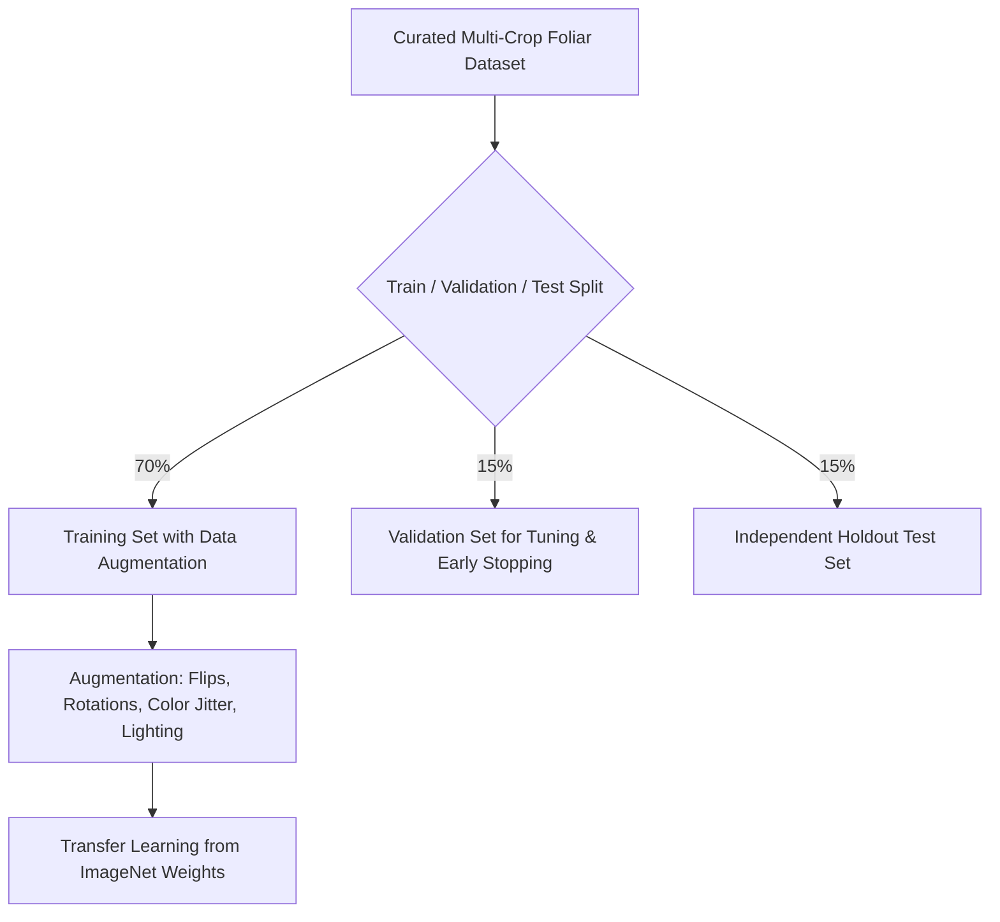

# AgriCare AI — Model Training and Dataset

## 1. Dataset Compilation & Provenance
The model training dataset was assembled to represent foliar pathologies common to sub-tropical agricultural climates, combining verified open-source agricultural corpora (e.g., PlantVillage, regional academic datasets) with curated field samples of Bangladeshi staple crops.

---

## 2. Dataset Distribution Across 19 Classes

| Crop | Class Name in Model (`labels.json`) | Type | Target Pathogen / Condition |
| :--- | :--- | :--- | :--- |
| **Rice** | `Rice___Bacterial_leaf_blight` | Disease | *Xanthomonas oryzae* pv. *oryzae* |
| **Rice** | `Rice___Brown_spot` | Disease | *Bipolaris oryzae* (*Cochliobolus miyabeanus*) |
| **Rice** | `Rice___Leaf_smut` | Disease | *Entyloma oryzae* |
| **Rice** | `Rice___healthy` | Healthy | Intact rice leaf blade |
| **Potato** | `Potato___Early_blight` | Disease | *Alternaria solani* |
| **Potato** | `Potato___Late_blight` | Disease | *Phytophthora infestans* |
| **Potato** | `Potato___healthy` | Healthy | Intact potato foliage |
| **Tomato** | `Tomato___Bacterial_spot` | Disease | *Xanthomonas perforans* |
| **Tomato** | `Tomato___Early_blight` | Disease | *Alternaria solani* |
| **Tomato** | `Tomato___Late_blight` | Disease | *Phytophthora infestans* |
| **Tomato** | `Tomato___Leaf_Mold` | Disease | *Passalora fulva* (*Cladosporium fulvum*) |
| **Tomato** | `Tomato___Septoria_leaf_spot` | Disease | *Septoria lycopersici* |
| **Tomato** | `Tomato___healthy` | Healthy | Intact tomato foliage |
| **Mango** | `Mango___Anthracnose` | Disease | *Colletotrichum gloeosporioides* |
| **Mango** | `Mango___Bacterial_canker` | Disease | *Xanthomonas citri* pv. *mangiferaeindicae* |
| **Mango** | `Mango___healthy` | Healthy | Intact mango leaf blade |
| **Jute** | `Jute___Stem_rot` | Disease | *Macrophomina phaseolina* |
| **Jute** | `Jute___Anthracnose` | Disease | *Colletotrichum corchori* |
| **Jute** | `Jute___healthy` | Healthy | Intact jute leaf blade |

---

## 3. Data Augmentation Pipeline
To combat field variances such as erratic sunlight, shadow cast, and camera sensor differences in rural Bangladesh, training applied extensive stochastic augmentations:
- **Random Horizontal and Vertical Flips**: Simulates varying leaf hanging orientations.
- **Random Rotation ($\pm 30^{\circ}$)**: Compensates for arbitrary smartphone holding angles.
- **Color Jitter (Brightness $\pm 0.2$, Contrast $\pm 0.2$)**: Emulates morning, midday, and overcast field illumination.
- **Random Zoom & Crop ($0.8 \times$ to $1.2 \times$)**: Reflects differing farmer photographing distances.
