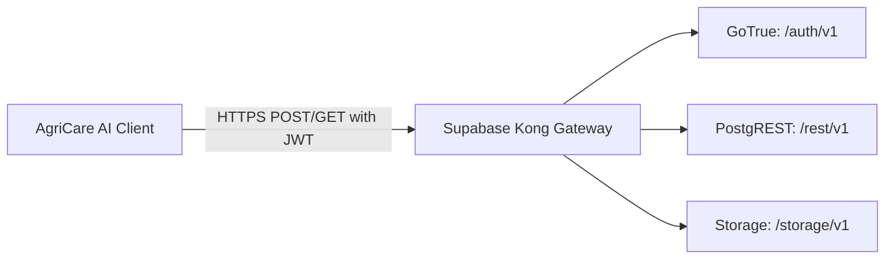

# AgriCare AI — API Overview

## 1. Cloud Architecture & Protocol
AgriCare AI interacts with its cloud backend via **Supabase PostgREST** and **GoTrue Auth** services. All endpoints communicate over TLS 1.3 encrypted HTTPS channels, adhering to REST conventions with JSON payloads and Bearer token authentication.



---

## 2. Base URIs and Security Headers
- **Base Endpoint**: `https://<supabase-project-id>.supabase.co`
- **REST Root**: `/rest/v1`
- **Auth Root**: `/auth/v1`
- **Storage Root**: `/storage/v1`

### Standard Request Headers
```http
apikey: <SUPABASE_ANON_KEY>
Authorization: Bearer <USER_JWT_TOKEN>
Content-Type: application/json
Prefer: return=representation
```

---

## 3. Summary of API Services

| Service Name | Path Prefix | Operations | Description |
| :--- | :--- | :--- | :--- |
| **Authentication API** | `/auth/v1` | `POST /signup`, `POST /token?grant_type=password`, `POST /recover`, `POST /logout` | User registration, credential login, password resets, session refreshment. |
| **User Profile API** | `/rest/v1/profiles` | `GET`, `PATCH` | Read profile info, update name, phone, preferred language, and district. |
| **Crop Catalog API** | `/rest/v1/crops` | `GET` | Retrieve verified list of 5 crops and agronomic details. |
| **Disease Catalog API** | `/rest/v1/disease_catalog` | `GET` | Read 19-class pathology encyclopedia and symptom references. |
| **Recommendations API** | `/rest/v1/recommendations` | `GET` | Fetch verified cultural, organic, and chemical treatment guidelines. |
| **Disease Scans API** | `/rest/v1/disease_scans` | `GET`, `POST`, `DELETE` | Persist diagnosis history records and query past scans. |
| **Plant Observations API** | `/rest/v1/plant_observations` | `GET`, `POST`, `PATCH` | Store longitudinal recovery checkpoints for Screen 21. |
| **Notifications API** | `/rest/v1/notifications` | `GET`, `PATCH` | Read notification alerts and mark records as read. |
| **Feedback API** | `/rest/v1/feedback` | `POST` | Submit 5-star user ratings and feedback messages. |
| **Storage API** | `/storage/v1/object` | `POST /plant-images`, `GET /plant-images` | Store and retrieve leaf photographs in encrypted cloud buckets. |
