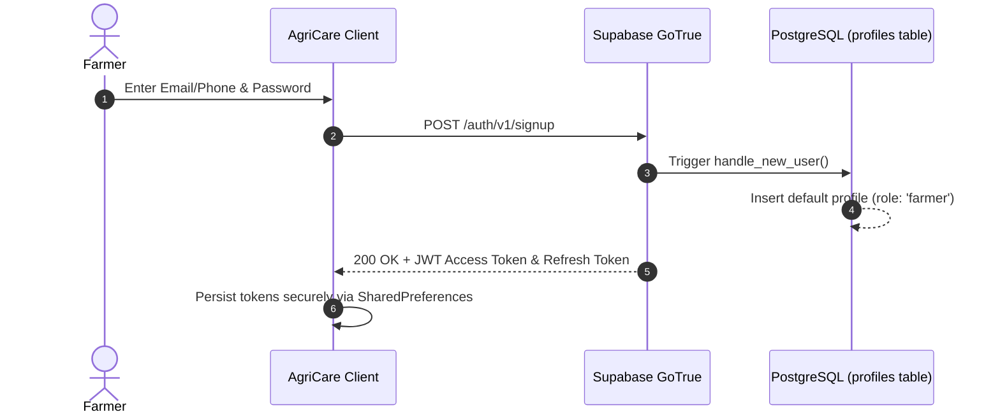

# AgriCare AI — Authentication API

## 1. Overview
User authentication is managed by Supabase GoTrue, issuing standard RS256 JSON Web Tokens (JWT) with automatic refresh token rotation.



---

## 2. Endpoints Specification

### A. Register New Farmer
- **Endpoint**: `POST /auth/v1/signup`
- **Headers**: `apikey: <ANON_KEY>`, `Content-Type: application/json`
- **Request Body**:
```json
{
  "email": "farmer@example.com",
  "password": "StrongPassword123!",
  "data": {
    "full_name": "Md. Rafiqul Islam",
    "phone_number": "+8801712345678",
    "district": "Bogura",
    "preferred_language": "bn",
    "terms_accepted_at": "2026-11-13T10:00:00Z"
  }
}
```
- **Success Response (200 OK)**:
```json
{
  "access_token": "eyJhbGciOi...",
  "token_type": "bearer",
  "expires_in": 3600,
  "refresh_token": "8x...d2",
  "user": {
    "id": "a1b2c3d4-e5f6-7890-abcd-ef1234567890",
    "email": "farmer@example.com",
    "created_at": "2026-11-13T10:00:01Z"
  }
}
```

### B. Farmer Login (Password Grant)
- **Endpoint**: `POST /auth/v1/token?grant_type=password`
- **Request Body**:
```json
{
  "email": "farmer@example.com",
  "password": "StrongPassword123!"
}
```
- **Success Response (200 OK)**: Returns standard JWT access token and user metadata.

### C. Forgot Password / Password Reset
- **Endpoint**: `POST /auth/v1/recover`
- **Request Body**:
```json
{
  "email": "farmer@example.com"
}
```
- **Success Response (200 OK)**:
```json
{}
```

### D. Logout
- **Endpoint**: `POST /auth/v1/logout`
- **Headers**: `Authorization: Bearer <TOKEN>`
- **Success Response (204 No Content)**

