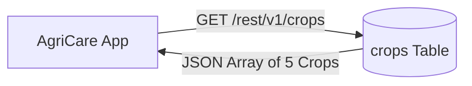

# AgriCare AI — Crop API

## 1. Overview
The Crop API provides read access to the verified agricultural catalog of crops cultivated in Bangladesh, including Bengali/English botanical descriptions and agronomic metadata.



---

## 2. Endpoints Specification

### A. List All Supported Crops
- **Endpoint**: `GET /rest/v1/crops?select=*&is_active=eq.true`
- **Headers**: `apikey: <ANON_KEY>`
- **Authentication**: Public / Anon or Authenticated
- **Success Response (200 OK)**:
```json
[
  {
    "id": 1,
    "name_en": "Rice",
    "name_bn": "ধান",
    "description_en": "Rice is the primary staple food crop of Bangladesh, cultivated across Aus, Aman, and Boro seasons.",
    "description_bn": "ধান বাংলাদেশের প্রধান খাদ্যশস্য, যা আউশ, আমন ও বোরো মৌসুমে ব্যাপকভাবে চাষ করা হয়।",
    "image_url": "https://xyz.supabase.co/storage/v1/object/public/disease-assets/crops/rice.jpg",
    "is_active": true
  },
  {
    "id": 2,
    "name_en": "Potato",
    "name_bn": "আলু",
    "description_en": "Potato is a vital winter cash crop widely grown in Munshiganj, Bogura, and Rangpur.",
    "description_bn": "আলু একটি অত্যন্ত গুরুত্বপূর্ণ শীতকালীন অর্থকরী ফসল যা মুন্সীগঞ্জ, বগুড়া এবং রংপুরে প্রধানত চাষ হয়।",
    "image_url": "https://xyz.supabase.co/storage/v1/object/public/disease-assets/crops/potato.jpg",
    "is_active": true
  },
  {
    "id": 3,
    "name_en": "Tomato",
    "name_bn": "টমেটো",
    "description_en": "Tomato is a nutrient-rich commercial vegetable cultivated in both winter and summer seasons.",
    "description_bn": "টমেটো একটি উচ্চ পুষ্টিগুণসম্পন্ন বাণিজ্যিক সবজি যা শীত ও গ্রীষ্ম উভয় মৌসুমে চাষ করা হয়।",
    "image_url": "https://xyz.supabase.co/storage/v1/object/public/disease-assets/crops/tomato.jpg",
    "is_active": true
  },
  {
    "id": 4,
    "name_en": "Mango",
    "name_bn": "আম",
    "description_en": "Mango is the king of fruits in Bangladesh, predominantly grown in Rajshahi and Chapainawabganj.",
    "description_bn": "আম বাংলাদেশের ফলের রাজা, যা মূলত রাজশাহী ও চাঁপাইনবাবগঞ্জ অঞ্চলে প্রচুর পরিমাণে উৎপাদিত হয়।",
    "image_url": "https://xyz.supabase.co/storage/v1/object/public/disease-assets/crops/mango.jpg",
    "is_active": true
  },
  {
    "id": 5,
    "name_en": "Jute",
    "name_bn": "পাট",
    "description_en": "Jute is the golden fiber of Bangladesh, representing a traditional export commodity and cash crop.",
    "description_bn": "পাট বাংলাদেশের সোনালী আঁশ, যা একটি ঐতিহ্যবাহী অর্থকরী ফসল হিসেবে সুপরিচিত।",
    "image_url": "https://xyz.supabase.co/storage/v1/object/public/disease-assets/crops/jute.jpg",
    "is_active": true
  }
]
```

### B. Get Crop by ID with Associated Diseases
- **Endpoint**: `GET /rest/v1/crops?id=eq.{crop_id}&select=*,disease_catalog(*)`
- **Headers**: `apikey: <ANON_KEY>`
- **Success Response (200 OK)**: Returns the selected crop combined with its nested array of verified diseases.
