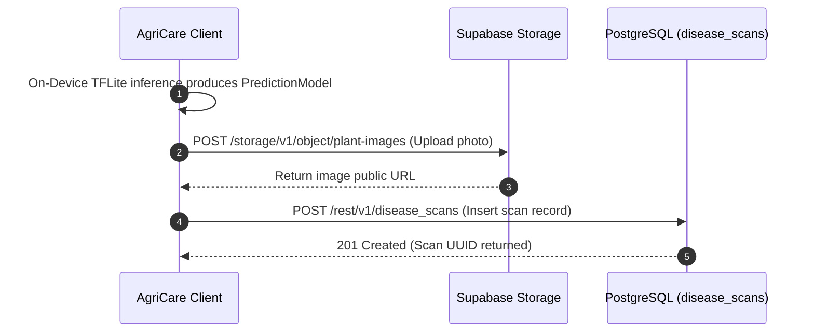

# AgriCare AI — Disease Detection API

## 1. Overview
While the deep learning classification model runs **entirely offline** on the smartphone hardware, detection results are synchronized with the cloud backend whenever an active network connection exists. This persistence enables historical timeline tracking, cross-device sync, and statistical research.



---

## 2. Endpoints Specification

### A. Record New Disease Scan
- **Endpoint**: `POST /rest/v1/disease_scans`
- **Headers**:
  - `apikey: <ANON_KEY>`
  - `Authorization: Bearer <USER_JWT>`
  - `Prefer: return=representation`
- **Request Body**:
```json
{
  "user_id": "a1b2c3d4-e5f6-7890-abcd-ef1234567890",
  "crop_name": "Rice",
  "detected_disease": "Rice Bacterial Leaf Blight",
  "confidence_score": 0.9412,
  "severity": "high",
  "image_url": "https://xyz.supabase.co/storage/v1/object/public/plant-images/scans/rice_123.jpg",
  "detection_result": {
    "class_name": "Rice___Bacterial_leaf_blight",
    "top_3_predictions": [
      {"class": "Rice___Bacterial_leaf_blight", "confidence": 0.9412},
      {"class": "Rice___Brown_spot", "confidence": 0.0410},
      {"class": "Rice___healthy", "confidence": 0.0178}
    ]
  }
}
```
- **Success Response (201 Created)**:
```json
[
  {
    "id": "f7e6d5c4-b3a2-1098-7654-3210fedcba98",
    "user_id": "a1b2c3d4-e5f6-7890-abcd-ef1234567890",
    "crop_name": "Rice",
    "detected_disease": "Rice Bacterial Leaf Blight",
    "confidence_score": 0.9412,
    "severity": "high",
    "image_url": "https://xyz.supabase.co/storage/v1/object/public/plant-images/scans/rice_123.jpg",
    "created_at": "2026-11-13T10:15:30Z"
  }
]
```

### B. Delete Disease Scan
- **Endpoint**: `DELETE /rest/v1/disease_scans?id=eq.{scan_id}`
- **Headers**: `Authorization: Bearer <USER_JWT>`
- **Success Response (204 No Content)**
- **Note**: Triggers cascading deletion of associated `treatment_history` and `plant_observations`.
