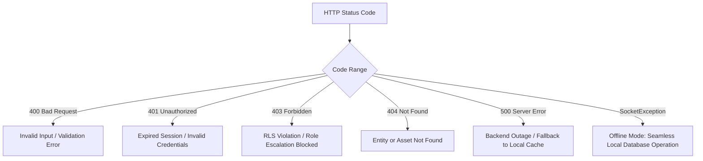

# AgriCare AI — API Error Handling

## 1. Error Representation
AgriCare AI maps backend API errors into structured, user-friendly domain exceptions that are gracefully communicated to the farmer in both English and Bengali.



---

## 2. Standard Error Response Schema
```json
{
  "code": "42501",
  "message": "new row violates row-level security policy for table \"disease_scans\"",
  "details": null,
  "hint": null
}
```

---

## 3. Client Exception Mapping

| Backend Error Code | HTTP Status | Client Exception | Farmer UI Message (English) | Farmer UI Message (Bangla) |
| :--- | :--- | :--- | :--- | :--- |
| `invalid_credentials` | 400 | `AuthException` | "Incorrect email or password." | "ভুল ইমেল বা পাসওয়ার্ড।" |
| `user_already_exists` | 422 | `UserExistsException` | "An account with this email already exists." | "এই ইমেল দিয়ে ইতিমধ্যে একটি অ্যাকাউন্ট রয়েছে।" |
| `42501` (RLS Violation) | 403 | `PermissionDeniedException`| "You do not have permission to access this record." | "এই তথ্য দেখার অনুমতি আপনার নেই।" |
| `SocketException` | N/A | `OfflineException` | "You are offline. Results saved locally." | "আপনি অফলাইনে আছেন। ফলাফল ডিভাইসে সংরক্ষিত হয়েছে।" |
| `storage_quota_exceeded`| 413 | `FileTooLargeException` | "Image size exceeds 10MB limit." | "ছবির সাইজ ১০ মেগাবাইটের বেশি হতে পারবে না।" |
