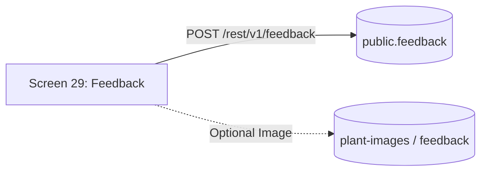

# AgriCare AI — Feedback API

## 1. Overview
The Feedback API allows farmers to submit genuine ratings and textual feedback regarding AI accuracy, app usability, or disease recommendations via Screen 29 (Feedback Screen).



---

## 2. Endpoints Specification

### A. Submit User Feedback
- **Endpoint**: `POST /rest/v1/feedback`
- **Headers**:
  - `apikey: <ANON_KEY>`
  - `Authorization: Bearer <USER_JWT>`
  - `Prefer: return=representation`
- **Request Body**:
```json
{
  "user_id": "a1b2c3d4-e5f6-7890-abcd-ef1234567890",
  "rating": 5,
  "category": "AI prediction accuracy",
  "message": "The Rice Bacterial Leaf Blight diagnosis was very accurate. The Copper Oxychloride treatment saved my crop."
}
```
- **Supported Categories**:
  - `AI prediction accuracy`
  - `App usability`
  - `Disease information`
  - `Treatment recommendations`
  - `Other`
- **Success Response (201 Created)**:
```json
[
  {
    "id": "c1d2e3f4-a5b6-7890-bcde-fa1234567890",
    "user_id": "a1b2c3d4-e5f6-7890-abcd-ef1234567890",
    "rating": 5,
    "category": "AI prediction accuracy",
    "message": "The Rice Bacterial Leaf Blight diagnosis was very accurate. The Copper Oxychloride treatment saved my crop.",
    "created_at": "2026-11-13T10:45:00Z"
  }
]
```

