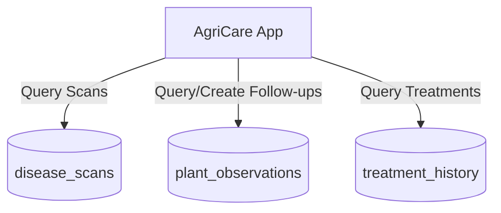

# AgriCare AI — History & Observation API

## 1. Overview
The History and Observation API powers Screen 22 (Detection History Dashboard), Screen 23 (History Details Screen), and Screen 21 (Plant Recovery & Follow-up). It manages both historical AI detections and longitudinal observation notes recorded by the farmer.



---

## 2. Endpoints Specification

### A. Fetch Detection History with Filters
- **Endpoint**: `GET /rest/v1/disease_scans`
- **Query Parameters**:
  - `user_id=eq.{user_id}`
  - `order=created_at.desc`
  - `limit=20`
  - Optional: `crop_name=eq.{CropName}`
  - Optional: `created_at=gte.{StartDate}&created_at=lte.{EndDate}`
- **Headers**:
  - `apikey: <ANON_KEY>`
  - `Authorization: Bearer <USER_JWT>`
- **Success Response (200 OK)**: Returns array of past scan records with confidence scores, timestamps, and thumbnails.

### B. Fetch Detailed Scan by ID
- **Endpoint**: `GET /rest/v1/disease_scans?id=eq.{scan_id}&select=*,treatment_history(*),plant_observations(*)`
- **Success Response (200 OK)**:
```json
[
  {
    "id": "f7e6d5c4-b3a2-1098-7654-3210fedcba98",
    "crop_name": "Rice",
    "detected_disease": "Rice Bacterial Leaf Blight",
    "confidence_score": 0.9412,
    "severity": "high",
    "image_url": "https://xyz.supabase.co/storage/v1/object/public/plant-images/scans/rice_123.jpg",
    "created_at": "2026-11-13T10:15:30Z",
    "plant_observations": [
      {
        "id": "obs_1",
        "condition_label": "better",
        "notes": "Applied Copper Oxychloride 3 days ago. Yellow lesions stopped expanding.",
        "created_at": "2026-11-16T08:30:00Z"
      }
    ]
  }
]
```

### C. Create Plant Recovery Observation (Screen 21)
- **Endpoint**: `POST /rest/v1/plant_observations`
- **Request Body**:
```json
{
  "id": "obs_unique_id",
  "scan_id": "f7e6d5c4-b3a2-1098-7654-3210fedcba98",
  "user_id": "a1b2c3d4-e5f6-7890-abcd-ef1234567890",
  "crop_name": "Rice",
  "condition_label": "better",
  "notes": "Leaves look greener; yellow striping halted.",
  "next_inspection_date": "2026-11-20T10:00:00Z"
}
```
- **Allowed `condition_label` Values**: `'better'`, `'no_change'`, `'worse'`, `'not_sure'`.
- **Success Response (201 Created)**: Returns the persisted observation entry.
