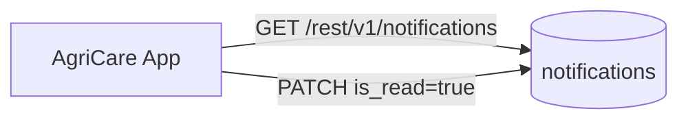

# AgriCare AI — Notification API

## 1. Overview
The Notification API powers Screen 27 (Notifications Screen), enabling farmers to view real in-app alerts generated by their own application activities, such as completed scans, observation milestones, and verified agricultural seasonal tips.



---

## 2. Endpoints Specification

### A. List User Notifications
- **Endpoint**: `GET /rest/v1/notifications?user_id=eq.{user_id}&order=created_at.desc`
- **Headers**:
  - `apikey: <ANON_KEY>`
  - `Authorization: Bearer <USER_JWT>`
- **Success Response (200 OK)**:
```json
[
  {
    "id": "notif_001",
    "user_id": "a1b2c3d4-e5f6-7890-abcd-ef1234567890",
    "title": "Follow-up Reminder",
    "message": "It has been 5 days since you logged Bacterial Leaf Blight for your Rice crop. Consider re-scanning.",
    "is_read": false,
    "created_at": "2026-11-13T09:00:00Z"
  },
  {
    "id": "notif_002",
    "user_id": "a1b2c3d4-e5f6-7890-abcd-ef1234567890",
    "title": "Welcome to AgriCare AI",
    "message": "Your account has been successfully configured for Bogura district.",
    "is_read": true,
    "created_at": "2026-11-12T14:20:00Z"
  }
]
```

### B. Mark Single Notification as Read
- **Endpoint**: `PATCH /rest/v1/notifications?id=eq.{notif_id}`
- **Request Body**:
```json
{
  "is_read": true
}
```
- **Success Response (200 OK)**

### C. Mark All Notifications as Read
- **Endpoint**: `PATCH /rest/v1/notifications?user_id=eq.{user_id}&is_read=eq.false`
- **Request Body**:
```json
{
  "is_read": true
}
```
- **Success Response (200 OK)**
