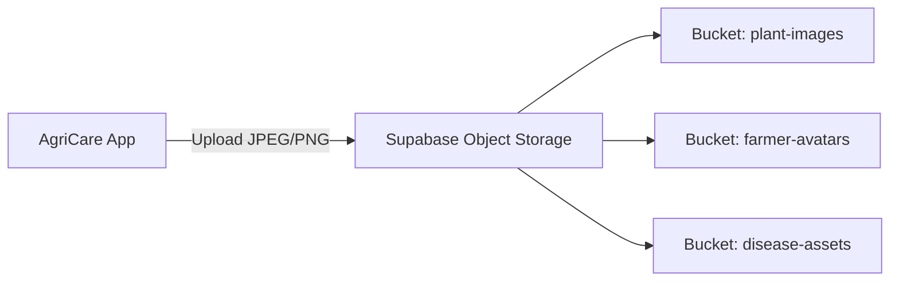

# AgriCare AI — Storage API

## 1. Storage Architecture
AgriCare AI manages leaf photographs, avatars, and visual evidence through **Supabase Object Storage**, an S3-compatible asset management service.



---

## 2. Storage Buckets Configuration
Verified in `supabase/migrations/004_storage_policies.sql`:

| Bucket Name | Public Access | Allowed MIME Types | Max File Size | Target Assets |
| :--- | :--- | :--- | :--- | :--- |
| **`plant-images`** | Public Read | `image/jpeg`, `image/png`, `image/webp` | 10 MB | Farmer disease scans, recovery checkpoints, feedback attachments |
| **`farmer-avatars`** | Public Read | `image/jpeg`, `image/png` | 5 MB | Farmer profile pictures |
| **`disease-assets`** | Public Read | `image/jpeg`, `image/png`, `image/svg+xml` | 10 MB | Curated high-res catalog disease reference photos |

---

## 3. Storage Operations

### A. Upload Leaf Image
- **Endpoint**: `POST /storage/v1/object/plant-images/scans/{filename}.jpg`
- **Headers**:
  - `Authorization: Bearer <USER_JWT>`
  - `Content-Type: image/jpeg`
  - `x-upsert: true`
- **Request Body**: Raw binary image bytes.
- **Success Response (200 OK)**:
```json
{
  "Key": "plant-images/scans/rice_scan_123.jpg"
}
```

### B. Public URL Construction
Images are publicly accessible via the CDN URL pattern:
`https://<project-id>.supabase.co/storage/v1/object/public/plant-images/scans/{filename}.jpg`

### C. Safe Upload & Orphan Cleanup Pattern
The application implements an orphan cleanup pattern: if database record creation fails after an image is uploaded to the storage bucket, the newly uploaded image is automatically deleted from storage to prevent orphaned disk leaks.

