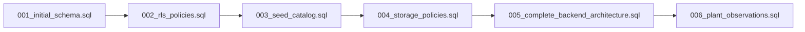

# AgriCare AI — Database Migrations History

## 1. Migration Log & Version History
All database modifications are version-controlled under `supabase/migrations/` and executed sequentially.



---

## 2. Detailed Migration Ledger

| Version | Migration Filename | Description | Impacted Entities |
| :--- | :--- | :--- | :--- |
| **001** | `001_initial_schema.sql` | Establishes core relational tables, user profile auto-trigger, initial crop and disease catalog structures. | `profiles`, `crops`, `disease_catalog`, `recommendations`, `prediction_history`, `feedback`, `notifications` |
| **002** | `002_rls_policies.sql` | Implements baseline Row Level Security (RLS) rules restricting tenant access via `auth.uid() = user_id`. | All tables in `public` |
| **003** | `003_seed_catalog.sql` | Inserts verified baseline records for the 5 target crops and 19 disease/healthy classes. | `crops`, `disease_catalog`, `recommendations` |
| **004** | `004_storage_policies.sql` | Configures S3 storage buckets (`plant-images`, `farmer-avatars`) and public read / authenticated upload policies. | `storage.buckets`, `storage.objects` |
| **005** | `005_complete_backend_architecture.sql` | Production overhaul: adds `farmer_crops`, `disease_scans`, `treatment_history`, indexes, and anti-role-escalation security triggers. | `profiles`, `farmer_crops`, `disease_scans`, `treatment_history`, `notifications`, `feedback` |
| **006** | `006_plant_observations.sql` | Adds longitudinal recovery tracking table (`plant_observations`) with strict foreign keys, indexes, and RLS policies for Screen 21. | `plant_observations` |

---

## 3. Migration Execution Guidelines
Migrations are applied via the Supabase CLI:
```bash
supabase db push
# Or for local docker development:
supabase migration up
```
All migration files are written to be idempotent using `IF NOT EXISTS`, `IF EXISTS`, and safe constraint drops.
