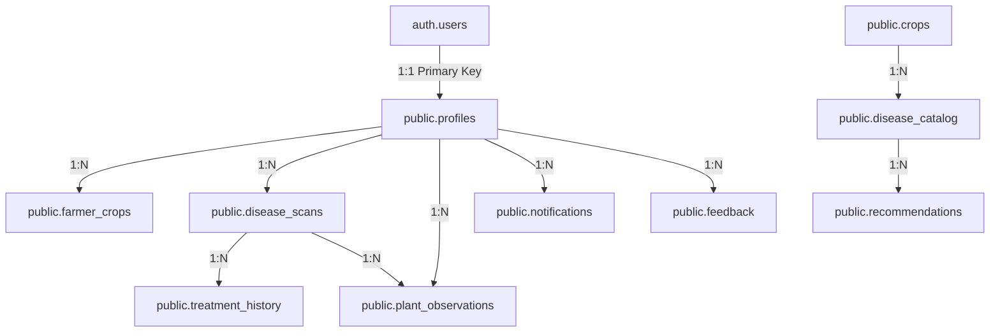

# AgriCare AI — Database Overview

## 1. Relational Database Engine
AgriCare AI utilizes **PostgreSQL 15+** managed on Supabase Cloud. PostgreSQL provides enterprise-class ACID transactions, JSONB document querying, Row Level Security (RLS), custom triggers, and spatial scalability.

---

## 2. Dual-Persistence (Offline + Cloud Sync)
To support rural agricultural reality:
1. **Local SQLite Cache**: Stores local copies of the crop catalog, 19 disease profiles, local treatment guidelines, and the farmer's recent scans.
2. **Cloud PostgreSQL**: Acts as the authoritative source of truth when internet connectivity is active, synchronizing historical scans and backup observations.
