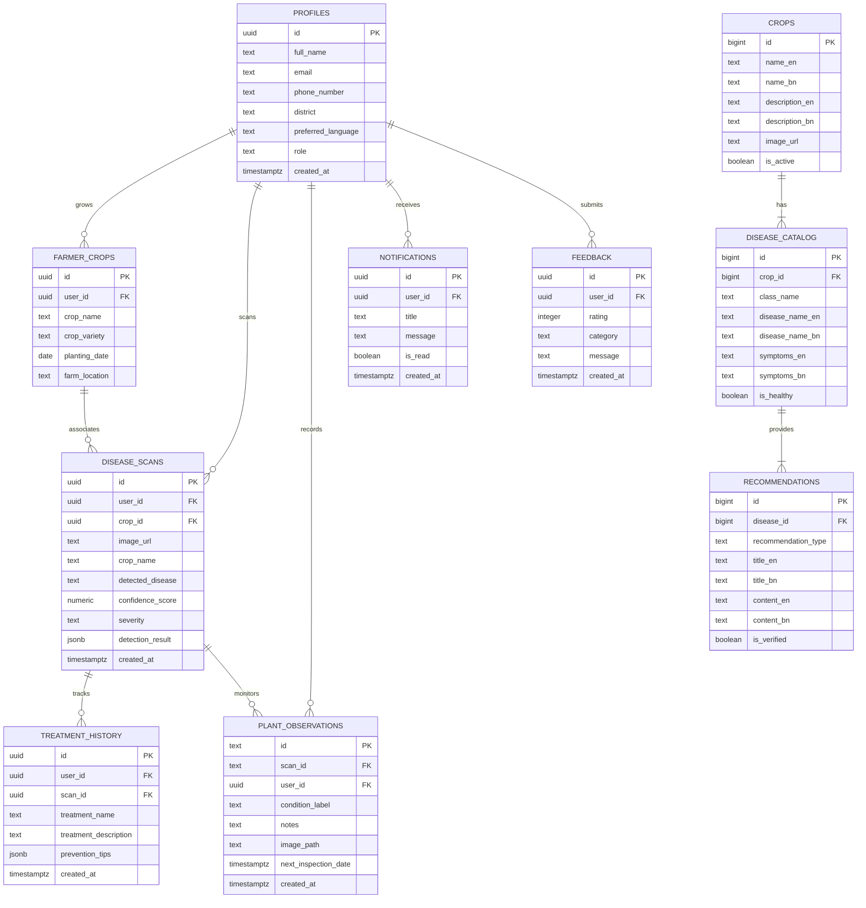

# AgriCare AI — Entity-Relationship Diagram (ERD)

## 1. Complete Entity-Relationship Diagram
The following Crow's Foot ERD maps all entities, primary keys (PK), foreign keys (FK), and cardinality relationships across the AgriCare AI database.

