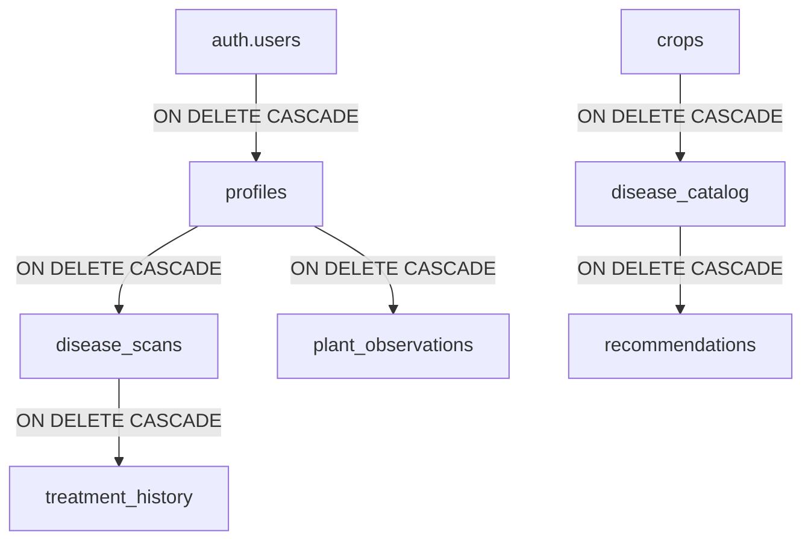

# AgriCare AI — Relationships and Constraints

## 1. Relational Integrity Rules
Foreign keys enforce referential integrity across the system. The deletion rules are strictly configured to prevent orphaned data.

---

## 2. Foreign Key & Cascade Policies

| Source Table | Foreign Key Column | Target Table & Column | On Delete Action | On Update Action |
| :--- | :--- | :--- | :--- | :--- |
| `public.profiles` | `id` | `auth.users(id)` | **CASCADE** | CASCADE |
| `public.disease_catalog`| `crop_id` | `public.crops(id)` | **CASCADE** | CASCADE |
| `public.recommendations`| `disease_id` | `public.disease_catalog(id)`| **CASCADE** | CASCADE |
| `public.farmer_crops` | `user_id` | `public.profiles(id)` | **CASCADE** | CASCADE |
| `public.disease_scans` | `user_id` | `public.profiles(id)` | **CASCADE** | CASCADE |
| `public.disease_scans` | `crop_id` | `public.farmer_crops(id)` | **SET NULL** | CASCADE |
| `public.treatment_history`| `user_id` | `public.profiles(id)` | **CASCADE** | CASCADE |
| `public.treatment_history`| `scan_id` | `public.disease_scans(id)` | **CASCADE** | CASCADE |
| `public.plant_observations`| `user_id` | `public.profiles(id)` | **CASCADE** | CASCADE |
| `public.notifications` | `user_id` | `public.profiles(id)` | **CASCADE** | CASCADE |
| `public.feedback` | `user_id` | `public.profiles(id)` | **CASCADE** | CASCADE |

---

## 3. CHECK Constraints & Data Validation
- `profiles_role_check`: `role IN ('farmer', 'agronomist', 'admin')`
- `profiles_preferred_language_check`: `preferred_language IN ('en', 'bn')`
- `disease_scans_confidence_check`: `confidence_score >= 0 AND confidence_score <= 1`
- `disease_scans_severity_check`: `severity IN ('low', 'moderate', 'high', 'critical')`
- `recommendations_type_check`: `recommendation_type IN ('treatment', 'prevention', 'care')`
- `plant_observations_condition_check`: `condition_label IN ('better', 'no_change', 'worse', 'not_sure')`
- `feedback_rating_check`: `rating BETWEEN 1 AND 5`
