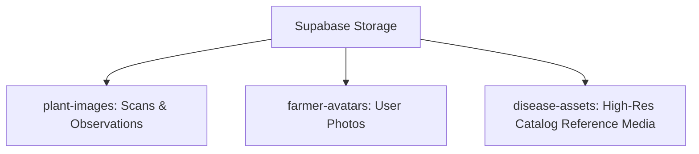

# AgriCare AI — Storage Buckets Configuration

## 1. Storage Buckets Overview
AgriCare AI utilizes Supabase Storage to manage binary assets with dedicated security and cache policies.

---

## 2. Bucket Configurations

### A. `plant-images` Bucket
- **Public**: `true` (Allows direct CDN rendering via public URLs)
- **File Size Limit**: `10485760` bytes (10 MB)
- **Allowed MIME Types**: `image/jpeg`, `image/png`, `image/webp`
- **RLS Access Policies**:
  - `SELECT`: Publicly accessible to read via CDN.
  - `INSERT`: Authenticated farmers can upload photos to user-scoped directories (`auth.uid() = (storage.foldername(name))[1]`).
  - `DELETE`: Farmers can delete their own uploaded scan images.

### B. `farmer-avatars` Bucket
- **Public**: `true`
- **File Size Limit**: `5242880` bytes (5 MB)
- **Allowed MIME Types**: `image/jpeg`, `image/png`
- **RLS Policies**: Uploads restricted to authenticated user id matching the object path.

### C. `disease-assets` Bucket
- **Public**: `true`
- **Access**: Read-only for general clients; uploads restricted to `service_role`.
- **Contents**: High-definition reference images of diseased leaves, crop icons, and agronomic diagrams.

