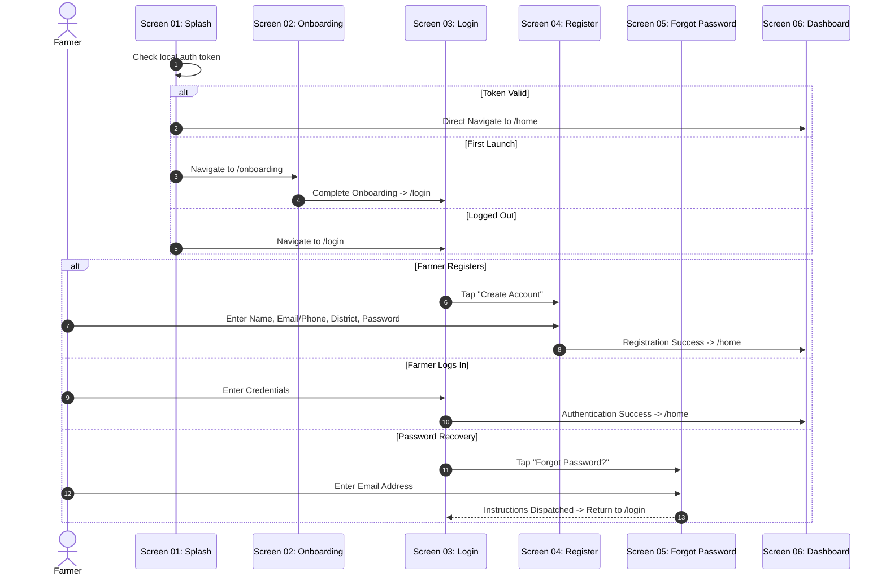

# AgriCare AI — Authentication Flow

## 1. Authentication Journey
The authentication flow guides farmers from initial splash launch to authenticated dashboard access.

---

## 2. Form Validations and Rules
- **Email/Phone**: Validates standard email regex or 11-digit Bangladeshi mobile format (`+8801XXXXXXXXX` or `01XXXXXXXXX`).
- **Password**: Minimum 8 characters; requires at least one numeral and one special character.
- **District Picker**: Displays searchable list of the 64 administrative districts of Bangladesh.
- **Terms Agreement**: Requires explicit checkbox agreement to privacy terms prior to registration.

