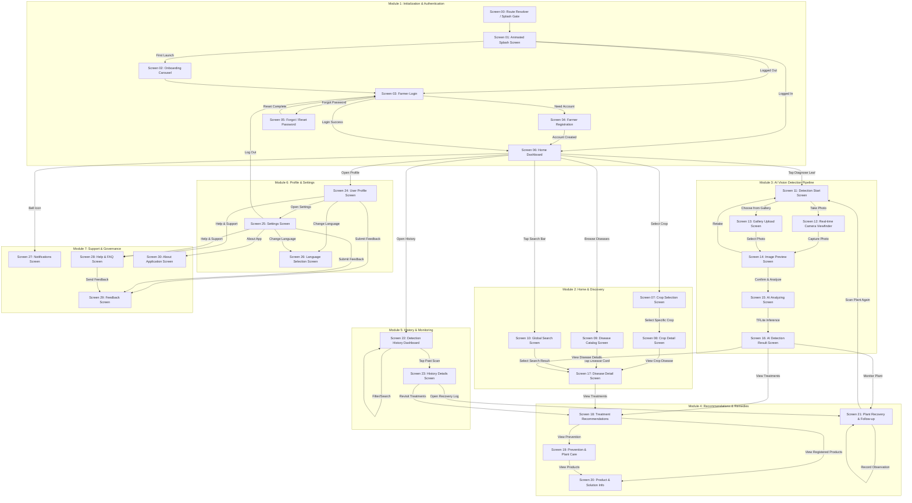

# AgriCare AI — Complete Application User Flow (Screens 00 to 30)

## 1. Master Application Flowchart
The following diagram details the end-to-end navigational paths, decision forks, and screen transitions across all 31 screens in AgriCare AI.

### Architectural Flow Graph

---

## 2. Screen Reference Table (Screens 00 to 30)

| Screen # | Screen Name | Route Path | Primary Function |
| :---: | :--- | :--- | :--- |
| **00** | Splash Gate / Resolver | `/splash` (Gate) | Directs authenticated vs. unauthenticated launch. |
| **01** | Splash Screen | `/splash` | Animated branding, leaf scanner animation, logo display. |
| **02** | Onboarding Screen | `/onboarding` | 3-step introduction to detection, remedies, and recovery. |
| **03** | Farmer Login | `/login` | Phone/Email authentication, password visibility toggle. |
| **04** | Farmer Registration | `/register` | New account creation, district dropdown, terms agreement. |
| **05** | Forgot / Reset Password | `/forgot-password`, `/reset-password` | Password reset email trigger and new password entry. |
| **06** | Home Dashboard | `/home` | Quick scan CTA, recent scans, crop carousel, weather/alerts. |
| **07** | Crop Selection Screen | `/crop-select` | Grid of 5 supported crops with selection highlighting. |
| **08** | Crop Detail Screen | `/crops/:id` | Agronomic guides, growth stages, crop-specific diseases. |
| **09** | Disease Catalog Screen | `/diseases` | 19-class searchable disease encyclopedia with filters. |
| **10** | Global Search Screen | `/search` | Real-time bilingual fuzzy search across crops & diseases. |
| **11** | Detection Start Screen | `/detect` | Launchpad for camera capture or photo gallery upload. |
| **12** | Camera Screen | `/detect/camera` | Fullscreen viewfinder, leaf alignment guides, flash toggle. |
| **13** | Gallery Upload Screen | `/detect/gallery` | System photo picker with format and size validation. |
| **14** | Image Preview Screen | `/detect/preview` | Quality preflight: blur detection, crop adjustment, retake. |
| **15** | AI Analyzing Screen | `/detect/analyzing` | Pulsing radar animation, on-device MobileNetV2 inference. |
| **16** | AI Detection Result | `/detect/result` | Primary diagnosis, confidence gauge, severity badge, CTAs. |
| **17** | Disease Detail Screen | `/diseases/:id` | Comprehensive symptoms, causal pathogens, biology. |
| **18** | Treatment Recommendations | `/recommendations/:id` | Cultural, organic, and chemical treatment protocols. |
| **19** | Prevention & Plant Care | `/prevention` | Field sanitation, spacing, irrigation, and rotation rules. |
| **20** | Product & Solution Info | `/solutions` | Directory of registered agrochemicals, dosages, and safety. |
| **21** | Plant Recovery & Follow-up| `/recovery` | Longitudinal observation checkpoints, recovery timeline. |
| **22** | Detection History | `/history` | Searchable scan archive with date range and crop filters. |
| **23** | History Details Screen | `/history/:id` | Revisit past scan, historical prediction, and remedy links. |
| **24** | User Profile Screen | `/profile` | Farmer identity, scan counts, district, quick setting shortcuts. |
| **25** | Settings Screen | `/settings` | Cache manager, model info, offline settings, legal links. |
| **26** | Language Selection Screen | `/settings/language` | Instant switch between English and Bengali (বাংলা). |
| **27** | Notifications Screen | `/notifications` | Activity notifications, reminders, mark-as-read controls. |
| **28** | Help & FAQ Screen | `/help` | 4 quick photo guides, 12 searchable FAQs, support options. |
| **29** | Feedback Screen | `/feedback` | 5-star rating, category picker, character-counted comments. |
| **30** | About Application Screen | `/about` | Academic capstone details, tech stack, disclaimers. |

