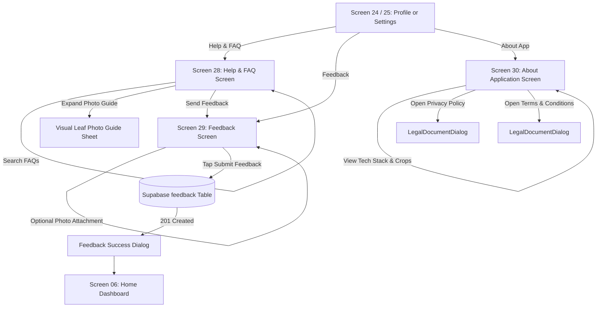

# AgriCare AI — Feedback and Support Flow

## 1. Support & Feedback Journey
Details farmer access to Help & FAQs (Screen 28), Feedback submission (Screen 29), and academic project disclosures (Screen 30).

---

## 2. Key Screen Capabilities
- **Screen 28 (Help & FAQ)**: Features 4 visual guides ("Taking Clear Leaf Photos", "Understanding AI Confidence", "Using Offline Mode", "Applying Treatment Safely") and 12 expandable FAQs with live search.
- **Screen 29 (Feedback)**: Interactive 5-star rating, 5 fixed categories, 2,000-character limit counter, optional image picker, and safe database submission.
- **Screen 30 (About Application)**: Academic capstone disclosures, tech stack, 5 verified crops, and legal terms.
