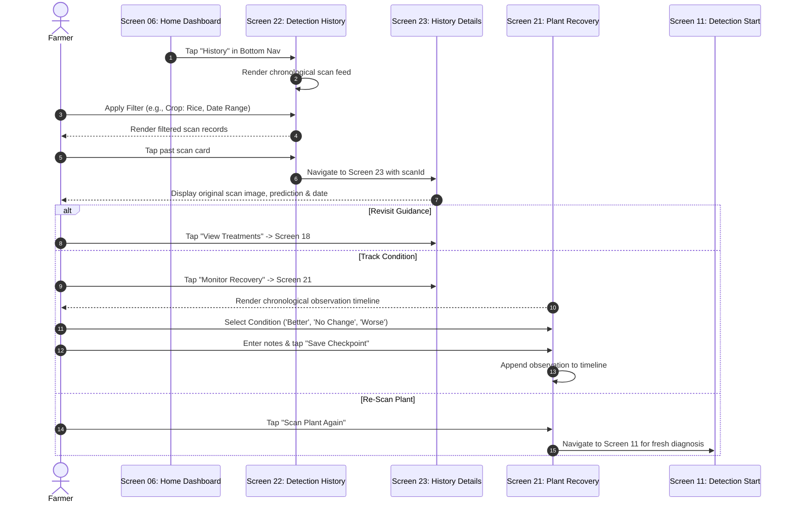

# AgriCare AI — History and Recovery Flow

## 1. Longitudinal Monitoring Journey
This workflow details how farmers browse past diagnosis records (Screens 22 & 23) and record visual observation milestones (Screen 21).

---

## 2. Key Safeguards & Integrity Rules
- **No Automatic Recovery**: Screen 21 never assumes or displays that a plant has recovered purely due to elapsed days.
- **Independent Record**: Observations are stored in `plant_observations` without altering the historical baseline in `disease_scans`.
- **Re-Scan CTA**: A prominent button on both Screen 21 and Screen 23 allows farmers to initiate a genuine new scan to verify plant health.

