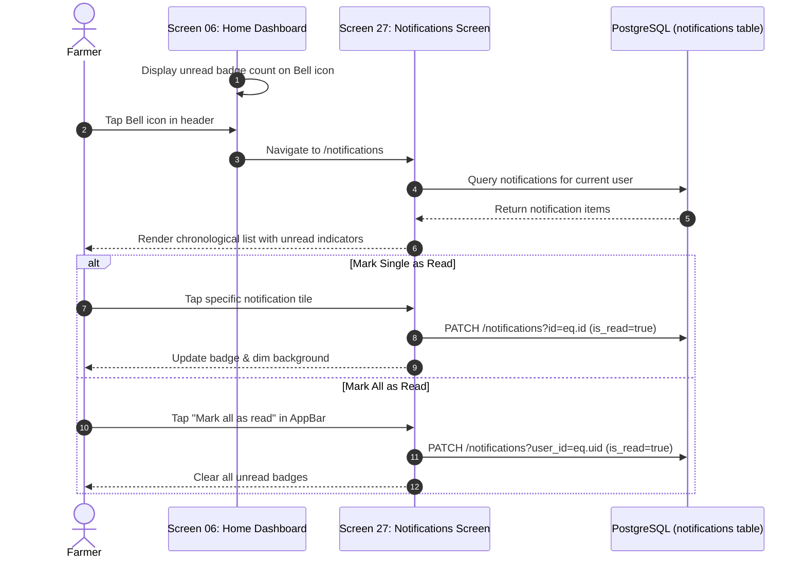

# AgriCare AI — Notification Flow

## 1. Notification Center Flow
Covers how notifications are viewed, filtered, and marked as read on Screen 27 (Notifications Screen).

---

## 2. Integrity Rule for Notifications
AgriCare AI only displays authentic notifications triggered by real application events:
- Completed offline/online scan confirmations.
- Observation checkpoint reminders for treated plants.
- Account updates and verified agronomic alerts.
Fabricated or simulated marketing notifications are strictly prohibited.
