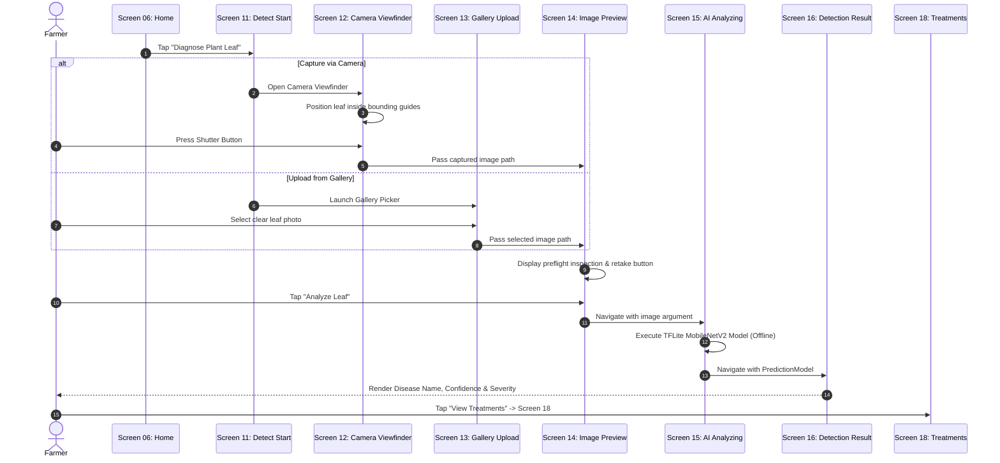

# AgriCare AI — Plant Detection Flow

## 1. Visual Detection Journey
The detection flow covers the complete path from photo capture to diagnostic result presentation.

---

## 2. Decision Points in Detection Flow
- **Blur Detection Warning**: On Screen 14, if the captured image exhibits low edge variance, an advisory banner encourages the user to retake.
- **Low Confidence Threshold**: On Screen 16, if confidence is $< 70\%$, a warning card suggests capturing a second photograph under indirect sunlight.
- **Save to History**: Detections are stored immediately in local SQLite and synchronized to Supabase `disease_scans` when online.
