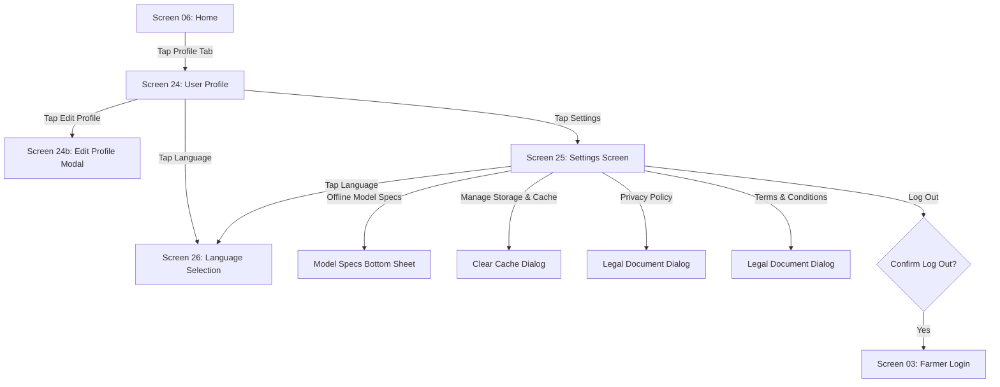

# AgriCare AI — Profile and Settings Flow

## 1. User Profile & Settings Journey
Covers farmer profile review (Screen 24), system configuration (Screen 25), and language selection (Screen 26).

---

## 2. Real-Time Language Switching
When a farmer selects English or বাংলা on Screen 26:
1. `settingsProvider` updates the `Locale` state in Riverpod.
2. The change persists to `SharedPreferences` under key `app_locale`.
3. The UI rebuilds immediately without requiring an application restart.
4. All Bengali text renders through Google Fonts `Noto Sans Bengali`.

