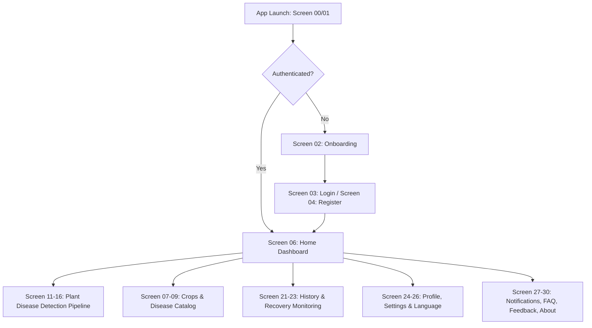

# AgriCare AI — User Flow Overview

## 1. User Journey Architecture
AgriCare AI provides a frictionless user journey tailored for farmers and agricultural workers. The interface structure spans 31 distinct screens (Screens 00 to 30) connected through intuitive routing paths.

---

## 2. Core Operational Modules
1. **Onboarding & Authentication (00–05)**: First-time value explanation, account registration, phone/email login, and password recovery.
2. **Dashboard & Information Hub (06–10)**: Fast-access actions, crop agronomy cards, 19-class disease catalog, and global keyword search.
3. **AI Vision Diagnostic Flow (11–16)**: Camera leaf alignment guide, gallery upload preflight, image preview, on-device neural analyzing, and diagnostic result presentation.
4. **Advisory & Solutions (17–20)**: Pathological details, cultural/organic/chemical remedies, preventative field care, and commercial agro-product directory.
5. **Recovery & History Audit (21–23)**: Longitudinal observation logging, condition checklists ('Better', 'No Change', 'Worse'), scan filtering, and historical record re-inspection.
6. **Account & Customization (24–26)**: Farmer profile stats, app settings, offline cache clearing, and instant English/Bangla language switching.
7. **Support & Governance (27–30)**: Activity notification center, searchable FAQ support hub, 5-star feedback submission, and academic capstone project disclosures.

