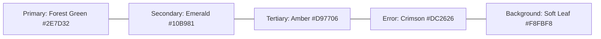

# AgriCare AI — Design System

## 1. Visual Identity & Color Palette
The design system of AgriCare AI is built upon Material Design 3 (MD3) with customized agricultural color tokens evoking health, vitality, and natural vegetation.

### Color Token Reference
- **Primary Green (`#2E7D32`)**: Used for primary action buttons, selected navigation items, and brand identity.
- **Secondary Emerald (`#10B981`)**: Used for high-confidence badges, success toasts, and healthy leaf indicators.
- **Surface / Background (`#F8FBF8`)**: Clean, low-glare surface color reducing eye strain during outdoor field use.
- **Warning Amber (`#D97706`)**: Used for moderate severity ratings and attention alerts.
- **Critical Red (`#DC2626`)**: Used for destructive actions (delete scan) and critical crop blight warnings.
- **Neutral Dark (`#1E293B`)**: High-contrast body text guaranteeing WCAG 2.1 AA legibility under direct sunlight.

---

## 2. Typography Specification
Typography is calibrated for dual-language legibility:
- **English**: Clean, geometric sans-serif (`Inter` or system Roboto).
- **Bangla (বাংলা)**: Google Fonts `Noto Sans Bengali` providing authentic rendering of Bengali vowel signs (কার), consonant conjuncts (যুক্তাক্ষর), and numerals (`০-৯`).

| Text Style | Font Size | Weight | Line Height | Usage |
| :--- | :--- | :--- | :--- | :--- |
| **Headline Large** | 28 dp | Bold (700) | 34 dp | Screen titles, hero banners |
| **Headline Medium**| 22 dp | Semi-Bold (600) | 28 dp | Section headers, disease names |
| **Title Medium** | 16 dp | Medium (500) | 24 dp | Card headers, list tile titles |
| **Body Large** | 15 dp | Regular (400) | 22 dp | Treatment descriptions, agronomy guides |
| **Body Medium** | 13 dp | Regular (400) | 18 dp | Timestamps, subtitles, secondary notes |
| **Label Small** | 11 dp | Medium (500) | 14 dp | Confidence tags, status chips |

---

## 3. Elevation, Radius, and Spacing
- **Corner Radius**: Standardized 16 dp for cards, 12 dp for text fields, and 28 dp for pill buttons.
- **Elevation**: Subtle Material 3 tonal elevation (0 to 3 dp) with soft ambient drop shadows.
- **Touch Targets**: Minimum 48x48 dp touch target boundary across all interactive elements.

