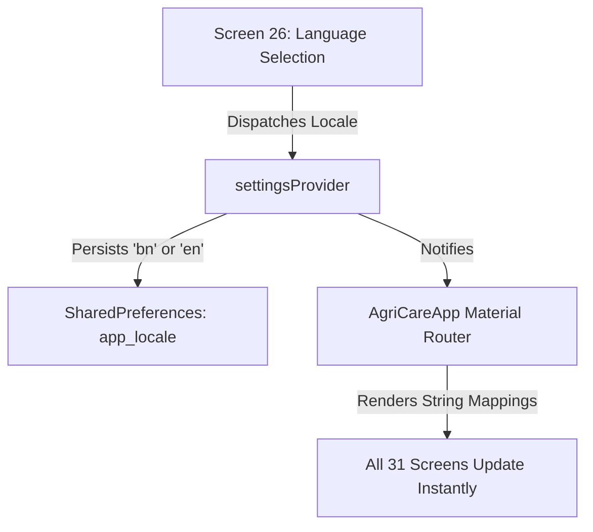

# AgriCare AI — Localization Architecture

## 1. Bilingual Architecture Overview
AgriCare AI provides comprehensive, simultaneous localization in **English (`en`)** and **Bengali (`bn`)** across all 31 screens.

---

## 2. Localization Mechanisms
1. **Application Strings**: JSON-based localization dictionaries located in `assets/translations/en.json` and `assets/translations/bn.json`.
2. **Database Multilingual Columns**: Relational tables feature dedicated parallel columns:
   - `crops`: `name_en`, `name_bn`, `description_en`, `description_bn`.
   - `disease_catalog`: `disease_name_en`, `disease_name_bn`, `symptoms_en`, `symptoms_bn`, `causes_en`, `causes_bn`.
   - `recommendations`: `title_en`, `title_bn`, `content_en`, `content_bn`.
3. **Numerals Formatting**: Automatic formatting converts Latin digits (`0-9`) to Bengali numerals (`০-৯`) when the active locale is set to `bn`.

---

## 3. Sample Translation Pairs

| Translation Key | English (`en`) | Bengali (`bn`) |
| :--- | :--- | :--- |
| `app_title` | AgriCare AI (LeafAgro) | এগ্রিকেয়ার এআই (লিফএগ্রো) |
| `diagnose_leaf` | Diagnose Plant Leaf | ফসলের পাতা পরীক্ষা করুন |
| `confidence` | Confidence | নির্ভুলতার মাত্রা |
| `treatment_recommendations` | Treatment Recommendations | প্রতিকার ও চিকিৎসা পরামর্শ |
| `cultural_methods` | Cultural Care | মাঠ ব্যবস্থাপনা ও পরিচর্যা |
| `chemical_methods` | Chemical Solutions | রাসায়নিক চিকিৎসা |
| `scan_again` | Scan Plant Again | পুনরায় পাতা স্ক্যান করুন |
| `condition_better` | Condition Improved | অবস্থার উন্নতি হয়েছে |
| `condition_worse` | Condition Worsened | অবস্থার অবনতি হয়েছে |
