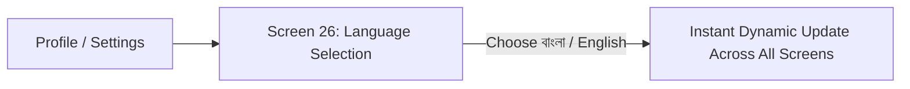

# AgriCare AI — Language Selection Guide

## 1. Changing App Language (Screen 26)
AgriCare AI offers full bilingual support in English and Bengali (বাংলা).

### How to Switch Languages:
1. Open your **Profile** (Screen 24) or **Settings** (Screen 25).
2. Tap **"Language"** or **"ভাষা নির্বাচন"**.
3. Select your preferred language:
   - **English** (US / UK standard agricultural English).
   - **বাংলা** (Standard Bengali formatted with authentic Noto Sans Bengali typography).
4. Tap **"Save"** or **"সংরক্ষণ করুন"**.
5. The application instantly refreshes its layout and text without needing to restart.

