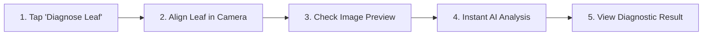

# AgriCare AI — Plant Disease Detection Guide

## 1. Step-by-Step Diagnosis Workflow
Detecting plant diseases with AgriCare AI takes under 10 seconds:

1. **Start Diagnosis (Screen 11)**:
   - On the Home Dashboard (Screen 06), tap the large green **"Diagnose Plant Leaf"** button.
   - Choose **"Take a Photo"** to open your camera, or **"Upload from Gallery"** if you already took a picture.
2. **Capture the Leaf (Screen 12)**:
   - Hold your phone steady approximately 15 to 25 cm (6 to 10 inches) above the diseased leaf.
   - Position the most visibly damaged section inside the green guide box.
   - If the lighting is dark, tap the lightning bolt icon at the top to turn on the camera flashlight.
   - Press the round green button at the bottom to snap the photo.
3. **Inspect the Preview (Screen 14)**:
   - Verify that the image is in sharp focus and that the disease spots are clearly visible.
   - If the photo is blurry or dark, tap **"Retake"**.
   - If the photo looks clear, tap **"Analyze Leaf"**.
4. **AI Processing (Screen 15)**:
   - The app's offline artificial intelligence will scan the leaf in less than a second.
5. **View Results (Screen 16)**:
   - The app will display the detected plant disease name, the confidence score percentage, and the severity level.
   - Tap **"View Treatments"** to access verified remedies immediately.
