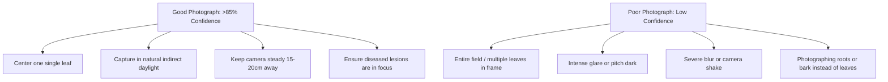

# AgriCare AI — How to Take Good Leaf Photos

## 1. Best Practices for Clear Leaf Photography
To achieve the highest diagnostic accuracy, follow these photography tips:

---

## 2. Recommended Photography Tips
1. **Focus on One Leaf at a Time**:
   - Do not photograph the whole crop canopy or an entire bush. Isolate one single leaf that clearly exhibits symptoms.
2. **Proper Lighting**:
   - Photograph your crops during daylight. Morning or late afternoon light without intense midday sun glare produces the best results.
   - If shooting under shade or thick foliage, use the app's flashlight button.
3. **Neutral Background**:
   - If other plants or weeds are distracting the camera, hold your hand or a neutral sheet behind the leaf to keep the focus sharp.
4. **Clean Lens**:
   - Farm work can make smartphone camera lenses dusty or smudged. Wipe your camera lens clean before snapping photos.
5. **Distance**:
   - Keep your camera between 15 and 25 cm away. Do not hold the phone so close that the lens cannot focus.

