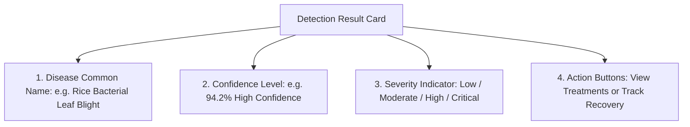

# AgriCare AI — Understanding Detection Results

## 1. Reading Screen 16 (AI Detection Result)
When an analysis finishes, Screen 16 presents four critical pieces of information:

---

## 2. Confidence Indicators Explained
- **Green Badge ($\ge 85\%$)**: The AI is highly certain of the diagnosis. The leaf symptoms closely match verified training patterns.
- **Amber Badge ($70\% - 84\%$)**: Reliable diagnosis. Read the symptoms on Screen 17 to double-check that your crop exhibits the same spots.
- **Orange Warning Badge ($50\% - 69\%$)**: The image may be slightly blurry, dark, or taken from too far away. We recommend taking another photo.
- **Red Alert ($< 50\%$)**: The app could not confidently diagnose this leaf. The leaf might belong to an unsupported crop, or the photo might be unclear.

---

## 3. Severity Levels Explained
- **Low Severity**: Early localized spots. Cultural care and bio-fungicides can quickly stop the infection.
- **Moderate Severity**: Lesions are spreading across several leaves. Apply targeted organic or chemical treatments promptly.
- **High / Critical Severity**: Extensive blight or leaf withering. Urgent chemical intervention is recommended to prevent field-wide yield collapse.
