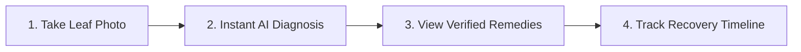

# AgriCare AI (LeafAgro) — Comprehensive User Manual

## 1. Introduction
Welcome to **AgriCare AI (LeafAgro)**, your pocket agricultural assistant designed to protect your crops from damaging plant diseases. Developed specifically for Bangladeshi farming conditions, AgriCare AI allows you to instantly diagnose diseases in your **Rice, Potato, Tomato, Mango, and Jute** fields using your smartphone camera—even when you do not have an internet connection.

---

## 2. Table of Contents
1. [Getting Started](getting_started.md)
2. [Account Registration and Login](account_registration_and_login.md)
3. [Plant Disease Detection Guide](plant_disease_detection_guide.md)
4. [Taking Good Leaf Photos](taking_good_leaf_photos.md)
5. [Understanding Detection Results](understanding_detection_results.md)
6. [Treatment and Prevention Guide](treatment_and_prevention_guide.md)
7. [Detection History Guide](detection_history_guide.md)
8. [Profile and Settings Guide](profile_and_settings_guide.md)
9. [Language Selection Guide](language_selection_guide.md)
10. [Help and Feedback Guide](help_and_feedback_guide.md)
11. [Troubleshooting Common Issues](troubleshooting.md)

---

## 3. Key App Features
- **Offline Machine Learning**: Diagnose plant diseases in the middle of your field without consuming mobile data.
- **5 Critical Crops**: High-accuracy detection across Rice, Potato, Tomato, Mango, and Jute.
- **19 Pathological Conditions**: Covers blights, spots, smuts, molds, rots, and confirms healthy leaves.
- **Scientifically Verified Remedies**: Step-by-step cultural sanitation, biological treatments, and exact chemical dosages.
- **Observation Tracking**: Record how your plants respond to treatment over time.
- **Dual Language**: Easily switch between English and বাংলা at any time.
