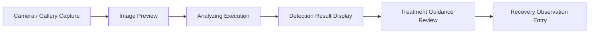

# AgriCare AI — Integration Testing

## 1. Scope of Integration Tests
Integration tests validate the end-to-end interactions between multiple screens, state notifiers, and local repositories.

---

## 2. Key Integration Scenarios
1. **Diagnosis to Treatment Flow**:
   - Starting from `DetectionStartScreen`, passing a sample leaf image to `AnalyzingScreen`.
   - Verifying that `DetectionResultScreen` renders the prediction accurately and correctly links to `TreatmentScreen` with the matching disease ID.
2. **History to Recovery Workflow**:
   - Selecting a past scan from `HistoryScreen`, opening `HistoryDetailScreen`, and navigating into `RecoveryScreen`.
   - Logging an observation ('Better') and confirming the entry appends to the timeline.
3. **Dynamic Locale Switching**:
   - Selecting Bangla on `LanguageScreen` and verifying that all dashboard widgets, navigation titles, and diagnosis results switch to Bengali script without restarting the app.

